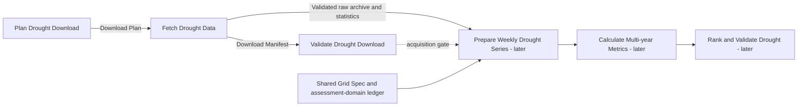

# Drought data acquisition and ModelBuilder implementation plan

Status: **acquisition implemented; original design retained below**. Sources and endpoints checked **2026-11-12**. This plan accompanies the [source/API findings](drought_sample_and_api_findings.md), [methods review](drought_hazard_methods_review.md), and [machine-readable research evidence](drought_research_evidence.json).

**Implementation update, 2026-11-12:** the acquisition plan is now implemented
in [Drought.atbx](../Drought.atbx) and [drought.py](../drought.py). See the
[actual Script Tool/ModelBuilder guide](drought_modelbuilder_setup.md) and
[execution/readiness report](drought_processing_readiness.md). The design below
is retained for rationale. The implemented cache uses content-addressed
`objects/`, request-index and receipt folders. GUI Drought graph assembly is
documented as a manual step; spatial indicators and ranking remain later work.

## 1. Recommended first implementation

Build a reproducible **USDM acquisition/audit model for Puerto Rico**, using the same external-script/Script Tool packaging pattern as Hurricane Winds. Acquire the weekly national merged-class shapefiles and PR reference statistics; retain raw snapshots and validate chronology, formats and coverage before later spatial processing.

Use **2000-2025**, ending on the last map date **2025-12-30**, as the baseline: **26 calendar-year cohorts and 1,357 weekly maps**. The live API returned exactly this chronology, and the official directory lists all matching GIS archives. A request beginning in 1955 returned no pre-2000 PR records. The professor's 40 files are a **weekly 2026 sample**, suitable for testing and possible recovery buffers, not the baseline dataset.

Use **1955-2025 only for a separately specified SPI/SPEI climate-data branch**, if matching the hurricane period is ultimately required. The [methods review](drought_hazard_methods_review.md#7-longer-historical-branch-realistic-options) covers candidates and a newly documented SPEIbase data defect. Do not synthesize unavailable USDM years or divide drought observations by the hurricane's 71-season denominator.

This first implementation should produce immutable archives, normalized reference tables, an expected-week ledger, provenance and a download-validation report. Spatial drought metrics and 1/3/5 ranking are the next implementation milestone.

## 2. Acquire two complementary data families

### A. Geometry: weekly merged-class shapefile ZIPs

Use the [official GIS download page](https://droughtmonitor.unl.edu/DmData/GISData.aspx) and [merged-shapefile directory](https://droughtmonitor.unl.edu/Data/shapefiles_m/). The tested historical archive is:

```text
https://droughtmonitor.unl.edu/Data/shapefiles_m/USDM_20000104_M.zip
```

Discover actual links from a frozen directory listing rather than relying only on synthesized URLs: names have mixed case in parts of the archive. Resolve each candidate to an expected Tuesday date and preserve its exact source URL. Request archives with **`Accept: */*`**; our `application/zip` request received 406, while the former succeeded.

These polygons carry the spatial drought categories. REST statistics alone do not supply 250 m spatial variation. The index lists **1.53 GB compressed** for the 1,357 individual baseline archives; allow additional disk space for extraction, working geodatabases and optional rasters. Initially download individual weeks for simple restart behavior. Annual bundles can be a later transport optimization after checking nested ZIPs, completeness and duplicate-date equivalence.

### B. Reference statistics: public REST GET requests

The [UNL service guide](https://droughtmonitor.unl.edu/DmData/DataDownload/WebServiceInfo.aspx) documents JSON/CSV content negotiation, geography identifiers and statistic formats. The following paths were **actually tested** in this research:

| Endpoint after `https://usdmdataservices.unl.edu/api/` | Geography / role |
|---|---|
| `StateStatistics/GetDroughtSeverityStatisticsByAreaPercent` | `aoi=72`; cumulative and categorical PR area percentages. |
| `StateStatistics/GetDSCI` | `aoi=72`; PR DSCI time series for a separate consistency check. |
| `CountyStatistics/GetDroughtSeverityStatisticsByAreaPercent` | `aoi=PR`; all municipios, preserving five-character FIPS. |
| `StateStatistics/GetBasicStatisticsByAreaPercent` | Optional threshold-filtered diagnostics; not the coverage calendar. |

Example request, with header **`Accept: application/json`**:

```text
https://usdmdataservices.unl.edu/api/StateStatistics/GetDroughtSeverityStatisticsByAreaPercent?aoi=72&startdate=1%2F1%2F2025&enddate=12%2F31%2F2025&statisticsType=1
```

`statisticsType=1` is cumulative; `2` is categorical. Preserve them as different formats. Dates use M/D/YYYY in the service request. DSCI uses its own endpoint without that format selector. For threshold diagnostics, the tested **GetBasicStatisticsByAreaPercent** route uses `dx`, `DxLevelThresholdFrom` and `DxLevelThresholdTo`. The documentation's threshold table and example do not use identical endpoint names; rely on the verified route and contract tests.

Default acquisition: state cumulative + categorical area percentages and DSCI; municipio categorical area percentages can be enabled for geographic QA. Population products are optional later exposure context and are not required for a physical hazard layer. API queries are public and used no credentials in our tests; recheck at implementation.

Use calendar-year chunks for resumability and stable receipts. A 26-year API query worked during this inspection, so annual chunking is a **project choice**, not a claimed API-wide maximum. Filter returned `mapDate` to the intended cohort after each response, sort explicitly, and reconcile duplicate boundary weeks: January queries can include a preceding December map because its validity interval overlaps the request.

## 3. Proposed code and storage layout

The names below are **planned new files**, not currently executable tools:

```text
drought.py                         public functions and CLI orchestration
utils/usdm_catalog.py              calendar, directory discovery, local-cache inventory
utils/usdm_download.py             HTTP transport, immutable cache, receipts
utils/usdm_statistics.py           schemas, dates, format normalization and table QA
utils/usdm_validation.py           acquisition and provenance checks
scripts/plan_drought_download.py   thin Script Tool adapter
scripts/fetch_drought_data.py      thin Script Tool adapter
scripts/validate_drought_download.py
```

Later add separate preparation/metric modules, rather than putting a climate-index engine inside the downloader. Reuse shared grid inputs and suitable existing utilities only after checking their assumptions; IBTrACS-specific flags and field handling do not belong in USDM processing.

Suggested run structure:

```text
run/
  plan/download_plan.json
  plan/drought_plan.gdb/expected_weeks
  cache/catalog/                   raw directory and provider documentation snapshots
  cache/gis/YYYY/YYYYMMDD/hash/    unmodified national source ZIPs
  cache/statistics/YYYY/hash/      original JSON responses
  acquire/download_manifest.json
  acquire/drought_acquisition.gdb/ statistics, acquisition_qc
  acquire/statistics_canonical.csv
  validate/download_validation.json + .md
```

Keep the professor's files unmodified. Preserve unknown original acquisition dates as unknown; a locally present file is not proof of when it was downloaded. A content-addressed cache permits preserving a revised provider file without overwriting a previous snapshot.

Use standard-library HTTP/JSON/ZIP/hash/date functionality for acquisition. Keep ArcPy at the integration/table-publication boundary and for later geoprocessing. No new wind/drought modeling dependencies are needed for this milestone.

## 4. Three visible Script Tools for the acquisition model

These proposed parameter indices are the adapter contract to implement. Date parameters use calendar dates; source JSON date strings are preserved without inventing a timezone conversion for map dates.

### Plan Drought Download (`PlanDroughtDownload`)

| Index | Parameter | Type / direction | Default or behavior |
|---|---|---|---|
| 0 | Start Date | Required Date Input | 2000-01-01 |
| 1 | End Date | Required Date Input | 2025-12-31 |
| 2 | Output Folder | Required Folder Input | Existing, writable plan folder. |
| 3 | Local Archive Folder | Optional Folder Input | Inventory the professor/cache ZIPs without altering them. |
| 4 | Include Municipio Statistics | Optional Boolean Input | True; state FIPS remains fixed to PR `72`. |
| 5 | Recovery Buffer Weeks | Optional Long Input | 3; separate role, excluded from the baseline denominator. |
| 6 | Mode | Optional String Input | `Baseline` or `Pilot`; default Baseline. |
| 7 | Download Plan | Derived File Output | JSON job plan and immutable cohort definition. |
| 8 | Expected Weeks | Derived Table Output | One date/role row per planned weekly product. |

Baseline mode requires complete calendar-year requests and rejects unsupported pre-2000 USDM start dates with a clear message. Pilot mode permits a bounded partial interval without calling it a climatology. Record requested dates, effective map-date bounds, baseline count, year count and buffer dates separately. Clamp unavailable pre-2000 event buffers explicitly and flag left censoring; never invent them.

### Fetch Drought Data (`FetchDroughtData`)

| Index | Parameter | Type / direction | Behavior |
|---|---|---|---|
| 0 | Download Plan | Required File Input | JSON from the planning stage. |
| 1 | Cache Folder | Required Folder Input | Existing immutable-archive cache root. |
| 2 | Output Folder | Required Folder Input | Existing acquisition-report/table folder. |
| 3 | Resume | Optional Boolean Input | True; reuse only verified matching artifacts. |
| 4 | Download Manifest | Derived File Output | Per-request receipts, files, dates, hashes and status. |
| 5 | Statistics | Derived Table Output | Normalized reference statistics with original format/source identity. |
| 6 | Acquisition QC | Derived Table Output | Missing, duplicate, schema and source-disagreement records. |
| 7 | Canonical Statistics CSV | Derived File Output | Portable normalized table; original JSON remains in cache. |

Fetch catalog links and missing archives, then retrieve statistics in annual chunks. Consider one serial request at a time with a configurable pause, bounded timeouts and retries for transient errors/429 responses. These are client design choices; no official rate limit was verified. Honor Retry-After when supplied. Report progress/cancellation between items and retain a partial manifest on failure.

### Validate Drought Download (`ValidateDroughtDownload`)

| Index | Parameter | Type / direction | Behavior |
|---|---|---|---|
| 0 | Download Manifest | Required File Input | Manifest from Fetch Drought Data. |
| 1 | Output Folder | Required Folder Input | Existing validation folder. |
| 2 | Report | Derived File Output | JSON report plus readable Markdown. |
| 3 | Passed | Derived Boolean Output | False/error on unresolved acquisition failures. |

Pass means the declared acquisition contract is satisfied, not that drought hazard or small-island coverage has been scientifically validated. Known statistical disagreements can be explicit warnings while raw acquisition remains complete; required missing weeks or invalid ZIPs are failures. Preserve the distinction in `ACQUISITION_STATUS`, `REFERENCE_QC_STATUS` and the report.

### ModelBuilder wiring



Create and connect the three acquisition Script Tools manually in the existing toolbox, preserving the Hurricane model. Expose source/cache/output paths and period controls as model parameters. Keep scripts and modules beneath the distribution root and relative to the toolbox. Publish typed outputs with `SetParameterAsText`/`SetParameter`.

Declare deterministic derived output paths in lightweight `ToolValidator.updateParameters` so downstream required inputs validate before files exist; the Hurricane saved-model test demonstrated why this matters. Do not make network requests, enumerate archives, read datasets or perform geoprocessing in pre-run validation. Perform those checks during execution. Expose retained model outputs so acquisition artifacts survive the model run. [Existing integration pattern](modelbuilder_setup.md)

The download transport itself needs no GIS extension. Record ArcGIS Pro version/license for Script Tool execution and table publication. The planned later Polygon To Raster path follows the project's current **Advanced** requirement; evaluate optional Spatial Analyst tools separately before selecting them.

## 5. Normalized contracts and provenance

The acquisition manifest should contain:

- Publisher/product family, effective map dates, intended period, expected counts and any buffer roles.
- Requested/final URLs, parameters, Accept header, retrieval UTC, HTTP status, byte counts, hash, Content-Type, and ETag/Last-Modified when actually supplied.
- National raw ZIP identity, member list, CRC status, original CRS/metadata references, local-source identity and unknown acquisition dates.
- Statistics geography (`72` or municipio FIPS), metric/unit, original format selector, original date strings, normalized map date and raw-response hash.
- Exact-duplicate versus conflicting-duplicate decisions, errors, warnings, source-revision identity, code/version information and output locations.

A normalized statistics row should retain geography type/key, map date, validity interval if supplied, metric, **CUMULATIVE/CATEGORICAL/INDEX**, category, numeric value, unit and source hash. DSCI lacks the same interval fields in the observed response; retain nulls rather than inventing provider values. Keep source D0-D4 and None names distinct from later raster codes or course scores.

Freeze source citations and the current [UNL permission/attribution statement](https://droughtmonitor.unl.edu/About/Permission.aspx). It authorizes third-party use with credit to NDMC/UNL, USDA, NOAA and NASA and data courtesy of NDMC. Preserve the supplied citation text in metadata; do not substitute an invented software/data license.

## 6. Acceptance checks for the first implementation

| Area | Required evidence |
|---|---|
| Calendar | 1,357 unique baseline Tuesdays, exactly 2000-01-04 to 2025-12-30; buffers counted separately; explicit exclusion of preceding overlap records. |
| Transport/cache | HTTPS, successful response, correct ZIP magic and CRC, expected sidecars, safe extraction paths, bounded unpacked size, receipts/hashes; an HTML error body must fail even with status 200. |
| Resume | A second run reuses verified files; corrupt/interrupted files are re-fetched; a provider revision cannot overwrite a frozen snapshot silently. |
| Schema | Date/member agreement; polygon geometry; actual CRS; raw DM domain; format selector and metric/unit retained; municipio FIPS stored as text. |
| Statistics | Percent bounds, cumulative monotonicity, categorical totals and cross-format differences, integer-presented DSCI tolerance; flag the observed 2015-08-04/11 discrepancies rather than normalizing them away. |
| Missingness | Empty threshold responses never establish a complete calendar or None conditions; missing files and unknown attributes remain explicit failures/unknowns. |
| Model integration | Execute the actual saved model in a clean folder, then repeat from a relocated distribution with spaces in paths; verify all published outputs and error propagation. |
| Source preservation | Professor/cache originals unchanged; input and output trees separate; source creation/acquisition/map dates not conflated. |

Use targeted transport fixtures for malformed ZIPs, 406 header behavior, 429/5xx retry, timeouts, overlapping dates, changed payloads and conflicting rows. Include a no-network warm-cache test. Pilot with one early digitized week, benchmark 2015 weeks including the two statistical anomalies, a recent complete year, and the local 2026 sample. Then fetch the full cohort. ModelBuilder validation should not depend on an internet connection until the fetch stage executes.

## 7. Subsequent processing milestones and decision gates

1. **Weekly series:** audit assessed-domain/island coverage, prepare/project PR working polygons and encode None/D0-D4/unknown correctly; reuse the shared grid. Resolve overlaps and preserve unknown weeks.
2. **Temporal indicators:** stream one week at a time into occupancy counts and event counters instead of building a large floating-point cube. Save continuous D1/D2 occupancy, average annual weeks, valid counts and censored-event diagnostics. See the [indicator formulas](drought_hazard_methods_review.md#5-recommended-multi-year-indicators).
3. **Method evaluation:** compare D1 versus D2, strict versus three-week-recovery events, boundary assignment, 2000-onward versus 2004-onward, and independent/partly dependent observations. Keep API consistency checks separate from scientific validation.
4. **Ranking:** calculate and freeze defensible numeric 1/3/5 breakpoints after the spatial indicator exists; compare an alternative rule and report land changing class. No numeric final breakpoints are asserted by this plan.
5. **Course integration:** write `RiskDrought_rank250.tif`, aligned exactly with the shared grid and with NoData for unsupported areas. Join the later Hurricane branch and propagate NoData through the rank sum. Produce the course's four-section report and individual/combined map layouts.

These gates allow acquisition work to begin without prematurely choosing a climate-index engine, an exposure model, or final hazard thresholds.

## Source register

All user-supplied references were accessed in this research. The dynamic map/form pages are contextual interfaces; the API and frozen archive index are the acquisition contracts.

| Reference | Role in the plan |
|---|---|
| [Puerto Rico current map](https://droughtmonitor.unl.edu/CurrentMap/StateDroughtMonitor.aspx?PR) | Visual/legend check; avoid scraping its dynamic controls for historical data. |
| [Web service information](https://droughtmonitor.unl.edu/DmData/DataDownload/WebServiceInfo.aspx) | API request patterns and geography/format selectors. |
| [Statistics by threshold](https://droughtmonitor.unl.edu/DmData/DataDownload/StatisticsbyThreshold.aspx) | Filtered diagnostic queries, not full chronology. |
| [DSCI download](https://droughtmonitor.unl.edu/DmData/DataDownload/DSCI.aspx) | Reference-series acquisition. |
| [Comprehensive statistics](https://droughtmonitor.unl.edu/DmData/DataDownload/ComprehensiveStatistics.aspx) | Unfiltered category/area series. |
| [Statistics explanation](https://droughtmonitor.unl.edu/About/AbouttheData/StatisticsExplanation.aspx) | Cumulative versus exact-category meanings; area versus population units. |
| [Population statistics](https://droughtmonitor.unl.edu/About/AbouttheData/PopulationStatistics.aspx) | Exposure-estimation assumptions and limitations. |
| [Drought classification](https://droughtmonitor.unl.edu/About/AbouttheData/DroughtClassification.aspx) | None, D0 and drought-class interpretation. |
| [GIS data](https://droughtmonitor.unl.edu/DmData/GISData.aspx) | Spatial products and attribution. |
| [USDM tutorial](https://drought.unl.edu/Education/Tutorials/Usdm.aspx) | Synthesis process and production timeline. |

Additional primary references: [GIS metadata](https://droughtmonitor.unl.edu/DmData/Metadata.aspx), [DSCI calculation](https://droughtmonitor.unl.edu/About/AbouttheData/DSCI.aspx), [release timeline](https://drought.unl.edu/Education/Tutorials/Usdm/Section-Six.aspx), and the research bibliography in the [methods review](drought_hazard_methods_review.md#references-research-articles).
