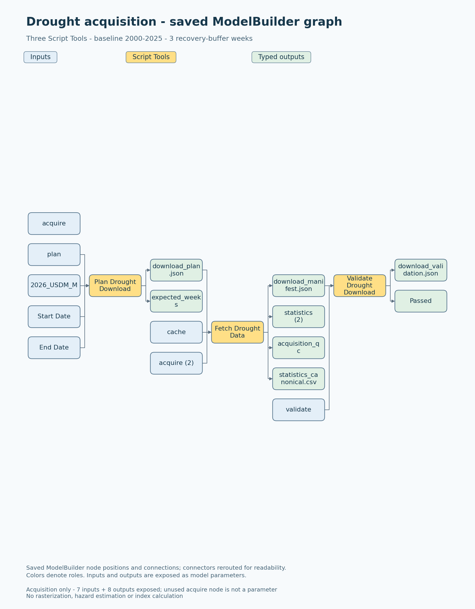
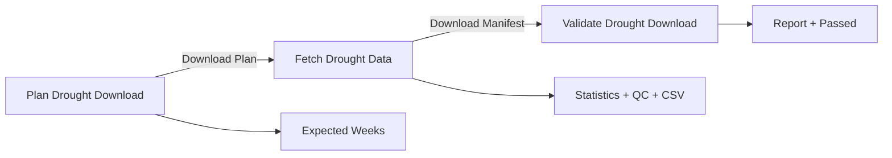

# Drought acquisition: Script Tools and ModelBuilder setup

The supplied **[DroughtRisk_Model_Toolbox.atbx](../DroughtRisk_Model_Toolbox.atbx)** contains three executable Script
Tools: **Plan Drought Download**, **Fetch Drought Data**, and **Validate Drought
Download**. They call the same [drought.py](../drought.py) functions as the CLI.
The toolbox alias is **droughtprobe**.

The toolbox now contains a saved ModelBuilder model with internal name
**Model**, three connected Script Tools, seven exposed inputs, and all eight
published derived outputs. Its professor-facing display label is
**Drought_Fetch_USDM**; the label does not change its ArcPy internal name.

The saved model was executed successfully from ArcGIS Pro Python against the
full **2000–2025** cohort into fresh outputs in **81.37 seconds**. It published
all eight outputs and returned **Passed=True**: **1,357 baseline maps**, **three
buffer maps**, **654,160 statistics rows**, and **231 preserved reference
warnings**. This was an execution of the actual saved ModelBuilder model, not
three independent Script Tool calls. See the
[execution receipt](../output/drought_modelbuilder_setup/saved_model_execution.json),
[geoprocessing messages](../output/drought_modelbuilder_setup/saved_model_messages.log),
and [validation report](../output/drought_model_baseline/validate/download_validation.json).
The report explicitly states **ready_for_rasterization=False**.



The [SVG diagram](drought_modelbuilder_graph.svg) renders saved node positions
and connections; connectors are rerouted for readability using persisted node
IDs so renamed file labels do not obscure their true dependencies. The unused
`acquire` node remains visible and is not a model parameter. The graph contains
19 nodes and 17 links; seven inputs and all eight derived outputs are exposed.
The [exporter](../tools/export_model_diagram.py) reads the toolbox without
modifying or authoring its ModelBuilder model.

## Saved model interface

In Catalog, double-click the model to open its geoprocessing dialog, or
right-click **Edit** to inspect the graph. Add the whole toolbox distribution;
keep the relative adapter/core/utilities paths intact.

The current saved model exposes **15 parameters**: seven inputs and eight
derived outputs. The table records their current saved order and labels. Names
such as `plan`, `cache`, and `acquire (2)` are variable labels; their defaults
point to the complete paths in the next section.

| Index | Current model label | Meaning | Direction |
|---|---|---|---|
| 0 | End Date | Last requested date: 2025-12-31 | Required input |
| 1 | download_plan.json | Frozen download plan | Derived output |
| 2 | expected_weeks | Planned weekly map dates and roles | Derived output |
| 3 | download_manifest.json | Download receipts and acquisition status | Derived output |
| 4 | statistics (2) | Normalized reference-statistics table | Derived output |
| 5 | acquisition_qc | Preserved source warnings | Derived output |
| 6 | statistics_canonical.csv | Portable normalized statistics | Derived output |
| 7 | download_validation.json | Acquisition validation report | Derived output |
| 8 | Passed | Acquisition validation result | Derived output |
| 9 | validate | Validation Folder | Required input |
| 10 | cache | Persistent Cache Folder | Required input |
| 11 | acquire (2) | Acquisition Output Folder | Required input |
| 12 | plan | Plan Output Folder | Required input |
| 13 | 2026_USDM_M | Professor's Local Archive Folder | Optional input |
| 14 | Start Date | First requested date: 2000-01-01 | Required input |

**Include Municipio Statistics=True**, **Recovery Buffer Weeks=3**,
**Mode=Baseline**, and **Resume=True** are fixed values inside the current model
stages. They remain adjustable by editing the stage dialogs or running the
individual Script Tools; they are not extra exposed model inputs. The internal
model can be called as `arcpy.droughtprobe.Model(...)`. The table above includes
derived outputs; those are not passed as Python call arguments. The verified
input-only call order is `End_Date, validate, cache, acquire__2_, plan,
_2026_USDM_M, Start_Date`. Inspect the imported tool's Python syntax/docstring
after changing the interface. Current model defaults use distribution-relative
source/output paths.

## Full-period model configuration in ArcGIS Pro

The current professor-facing model uses the complete available historical USDM
baseline, **2000-01-01 through 2025-12-31**. This is shorter than the hurricane
1955–2025 cohort because USDM begins in 2000. It is not a 2026 pilot model.

1. In Catalog, add the root-level
   [DroughtRisk_Model_Toolbox.atbx](../DroughtRisk_Model_Toolbox.atbx), then edit
   the model containing the three Script Tools.
2. Keep [drought.py](../drought.py), [scripts/](../scripts/), and
   [utils/](../utils/) beside/below the toolbox in the supplied folder structure.
   Do not copy the toolbox alone.
3. Create the three fresh existing writable output folders in the table below.
   GP Folder inputs require existing folders. Reuse the verified historical
   cache; keep it separate from the new plan/acquisition/validation outputs.
4. Configure these values, connect the stages, expose the model parameters,
   validate, save, and run. Inspect both the report and acquisition QC table.

All paths below are relative to the repository/distribution root; browse to the
corresponding absolute paths in ArcGIS Pro.

| Stage | Input | Current full-period value |
|---|---|---|
| Plan | Start Date | 2000-01-01 |
| Plan | End Date | 2025-12-31 |
| Plan | Output Folder | `output/drought_model_baseline/plan` |
| Plan | Local Archive Folder | `Hazard_Variables/Drought/2026_USDM_M` |
| Plan | Include Municipio Statistics | True |
| Plan | Recovery Buffer Weeks | 3 |
| Plan | Mode | Baseline |
| Fetch | Download Plan | Connect Plan's Download Plan output |
| Fetch | Cache Folder | `output/drought_baseline/cache` |
| Fetch | Output Folder | `output/drought_model_baseline/acquire` |
| Fetch | Resume | True |
| Validate | Download Manifest | Connect Fetch's Download Manifest output |
| Validate | Output Folder | `output/drought_model_baseline/validate` |

This cohort contains **1,357 baseline weekly maps plus three early-2026 end
buffers**, not 1,360 baseline observations. Pre-2000 start buffers are explicitly
unavailable. The 2026 professor archives are optional provenance/reference
inputs; they do not change the requested baseline. Buffer observations stay
separate for later event-boundary/censoring analysis.

The previously executed full-period acquisition under
[output/drought_baseline/](../output/drought_baseline/) passed download validation
with 654,160 normalized statistics rows; reference-statistics disagreements
remain recorded warnings. Reusing its cache with Resume=True verifies existing
bytes before reuse and avoids downloading the national archives again. This
earlier Script Tool/CLI result is separate from the successful saved-model
execution described above.

For an optional small smoke test only, use **2026-01-06 to 2026-01-27**,
**Mode=Pilot**, **Recovery Buffer Weeks=0**, and the separate
[output/drought_pilot/cache](../output/drought_pilot/cache). That pilot has four
weekly maps and does not replace the current full-period configuration.

## Explain the model to the professor

The three boxes form one **data-acquisition model**, with an auditable file
passed between each stage:

1. **Plan Drought Download** freezes the requested weekly dates, baseline/buffer
   roles, local source inventory and statistics jobs. It runs offline.
2. **Fetch Drought Data** retrieves or verifies cached GIS ZIPs and Puerto Rico
   reference statistics, records checksums and receipts, and publishes typed
   statistics/QC tables and a canonical CSV. It passes a manifest to validation.
3. **Validate Drought Download** independently rechecks the downloaded bytes,
   chronology, table counts and source preservation, then publishes Report and
   Passed. It runs offline and preserves source disagreements as warnings.

These stages establish a reproducible input dataset. Later work must assess
geometry and coverage, prepare/project/clip weekly polygons, resolve assessed
None versus missing coverage, and rasterize onto the shared 250 m grid.
Drought frequency, duration and event metrics follow that preparation. Hazard
indicator selection and validation, followed by the course's index/ranking
calculation, belong to a subsequent analysis model. **The third box here is
acquisition validation; it does not estimate drought hazard or calculate an
index.** A Passed=True acquisition does not certify those later scientific or
spatial readiness gates.

Generated downloads, geodatabases and logs belong under `output/` or another
chosen data workspace. The project's [.gitignore](../.gitignore) already excludes
generated outputs and raw hazard folders. MCP is **optional** for classmates;
the Script Tools run without an MCP client or new modeling dependencies.

## Exact Script Tool contracts

Type **Derived Output** means Type=Derived, Direction=Output. File filters use
extensions without a dot. The adapters depend on the parameter order below.

### Plan Drought Download

Internal name: `PlanDroughtDownload`.
Execution script: [scripts/plan_drought_download.py](../scripts/plan_drought_download.py).

| Index | Name / label | GP data type | Type/direction | Default |
|---|---|---|---|---|
| 0 | StartDate / Start Date | Date | Required Input | 1/1/2000 |
| 1 | EndDate / End Date | Date | Required Input | 12/31/2025 |
| 2 | OutputFolder / Output Folder | Folder | Required Input | Existing plan folder |
| 3 | LocalArchiveFolder / Local Archive Folder | Folder | Optional Input | Blank |
| 4 | IncludeMunicipioStatistics / Include Municipio Statistics | Boolean | Optional Input | True |
| 5 | RecoveryBufferWeeks / Recovery Buffer Weeks | Long | Optional Input | 3 |
| 6 | Mode / Mode | String | Optional Input | Baseline; value list Baseline/Pilot |
| 7 | DownloadPlan / Download Plan | File, json | Derived Output | `download_plan.json` |
| 8 | ExpectedWeeks / Expected Weeks | Table | Derived Output | `drought_plan.gdb/expected_weeks` |

Planning is offline. It freezes map dates, roles and local ZIP hashes. Baseline
mode requires complete calendar years before the current year; Pilot permits a
bounded partial interval. Buffers remain distinct from the indicator cohort.

### Fetch Drought Data

Internal name: `FetchDroughtData`.
Execution script: [scripts/fetch_drought_data.py](../scripts/fetch_drought_data.py).

| Index | Name / label | GP data type | Type/direction | Default |
|---|---|---|---|---|
| 0 | DownloadPlan / Download Plan | File, json | Required Input | Connect planning output |
| 1 | CacheFolder / Cache Folder | Folder | Required Input | Existing persistent cache |
| 2 | OutputFolder / Output Folder | Folder | Required Input | Existing acquisition folder |
| 3 | Resume / Resume | Boolean | Optional Input | True |
| 4 | DownloadManifest / Download Manifest | File, json | Derived Output | `download_manifest.json` |
| 5 | Statistics / Statistics | Table | Derived Output | `drought_acquisition.gdb/statistics` |
| 6 | AcquisitionQC / Acquisition QC | Table | Derived Output | `drought_acquisition.gdb/acquisition_qc` |
| 7 | CanonicalStatisticsCSV / Canonical Statistics CSV | File, csv | Derived Output | `statistics_canonical.csv` |

This stage retrieves the public directory, product/permission documentation,
required national GIS archives, state cumulative/categorical area percentages,
DSCI and optionally municipio categorical percentages. Inputs stay unchanged.
All bodies are content-addressed, checksummed and linked to request receipts.
Local copies retain unknown acquisition dates and are not falsely labeled as
content-equivalent to the current provider copy.

Resume reuses verified bodies. False refreshes HTTP requests while preserving
previous bodies/receipts. A failed run writes a failed/partial manifest and raises
a GP error; rerun with Resume=True after correcting the reported cause. Do not
pass a failed manifest into later analysis.

### Validate Drought Download

Internal name: `ValidateDroughtDownload`.
Execution script: [scripts/validate_drought_download.py](../scripts/validate_drought_download.py).

| Index | Name / label | GP data type | Type/direction | Behavior |
|---|---|---|---|---|
| 0 | DownloadManifest / Download Manifest | File, json | Required Input | Connect fetch output |
| 1 | OutputFolder / Output Folder | Folder | Required Input | Existing validation folder |
| 2 | Report / Report | File, json | Derived Output | `download_validation.json`; Markdown alongside |
| 3 | Passed / Passed | Boolean | Derived Output | True on acquisition success |

Validation runs offline, rechecks real ZIP hashes/CRC/header/index/schema,
reconstructs canonical statistics from the frozen JSON, checks chronology and
typed table counts, and verifies source preservation. Statistical source
disagreements are retained warnings; they are not silently repaired. Failures
leave a readable report, set Passed=False, and fail the tool.

**Passed=True does not mean raster-ready.** The report separately states that
assessment coverage, full geometry/topology, None encoding and scientific
evaluation remain later processing gates.

## Assemble and save the model

1. In [DroughtRisk_Model_Toolbox.atbx](../DroughtRisk_Model_Toolbox.atbx), choose
   **New > Model**, or continue editing the existing GUI model. Its current
   internal name is **Model**; use **Drought_Fetch_USDM** as the professor-facing display
   label. Retain internal name **Model** and save it into this toolbox.
2. Drag the three tools onto the canvas, or right-click each tool in Catalog and
   choose **Add To Model** with that model open.
3. Configure the full-period values in the table above and each tool's
   **separate** output folder. Configure Fetch's existing historical Cache Folder
   and Resume=True.
4. Connect **Download Plan** from Plan Drought Download to **Download Plan** on
   Fetch Drought Data.
5. Connect **Download Manifest** from Fetch Drought Data to **Download Manifest**
   on Validate Drought Download. Selecting the upstream model variable in the
   downstream tool's parameter dropdown is equivalent to drawing the connection.
6. For the current interface, expose only dates and the five source/cache/output
   Folder inputs: Plan, Local Archive, Cache, Acquisition, and Validation. Keep
   Municipio=True, Recovery Buffer Weeks=3, Mode=Baseline and Resume=True inside
   their stages. Right-click an existing input variable and select **Parameter**.
   To expose a missing one, right-click its tool, select **Create Variable > From
   Parameter**, then right-click the resulting variable and select **Parameter**.
   Use distinct folder variable names when authoring a new model.
7. Expose all published outputs as model parameters so they survive execution
   and can connect to later processing. The final Report and Passed outputs are
   acquisition outcomes, not final hazard maps.
8. Auto Layout, validate, **Save**, then run into clean output folders. Check that
   files actually exist; success messages/declared derived paths alone are not
   enough. Repeat after moving the complete distribution folder.



This is a simplified wiring guide. The supplied saved model has been wired and
executed as recorded above; the rendered diagram above shows its saved node positions. The CLI runs the same core acquisition logic.

## CLI and reproducibility

From an ArcGIS Pro Python prompt in the distribution root:

```powershell
python drought.py run --output-folder "output/drought_baseline" --local-archive-folder "Hazard_Variables/Drought/2026_USDM_M" --arcpy-tables
```

For the small pilot:

```powershell
python drought.py run --start-date 2026-01-06 --end-date 2026-01-27 --mode Pilot --recovery-buffer-weeks 0 --output-folder "output/drought_pilot" --local-archive-folder "Hazard_Variables/Drought/2026_USDM_M" --arcpy-tables
```

Without `--arcpy-tables`, the same core can use standard Python and publish CSV
tables. Add `--offline` to prove a fully cached CLI run needs no network. Use
`python drought.py --help` for separate plan/fetch/validate commands. For a
no-network rerun into different report folders, retain the original verified
cache and call the individual stages with that cache path.

Rebuild/verify the Script Tool definitions using:

```powershell
python tools/build_drought_toolbox.py --overwrite --verify
```

Close Drought toolbox editing before regeneration. The builder preserves any
other saved tools/model archive members in that toolbox. It does not author a
ModelBuilder graph. The existing Hurricane toolbox need not be regenerated.

Tool validators declare deterministic output paths but do not access the network
or inspect input datasets during dialog validation. Actual execution checks
archives, records and geometry headers. No new ArcGIS extension is needed for
this acquisition/table workflow; the separate diagnostic Polygon To Raster pilot
used the installed Advanced license.

See [processing readiness](drought_processing_readiness.md),
[implementation details](drought_download_implementation_plan.md), and
[methods/literature](drought_hazard_methods_review.md) for the next stages.
