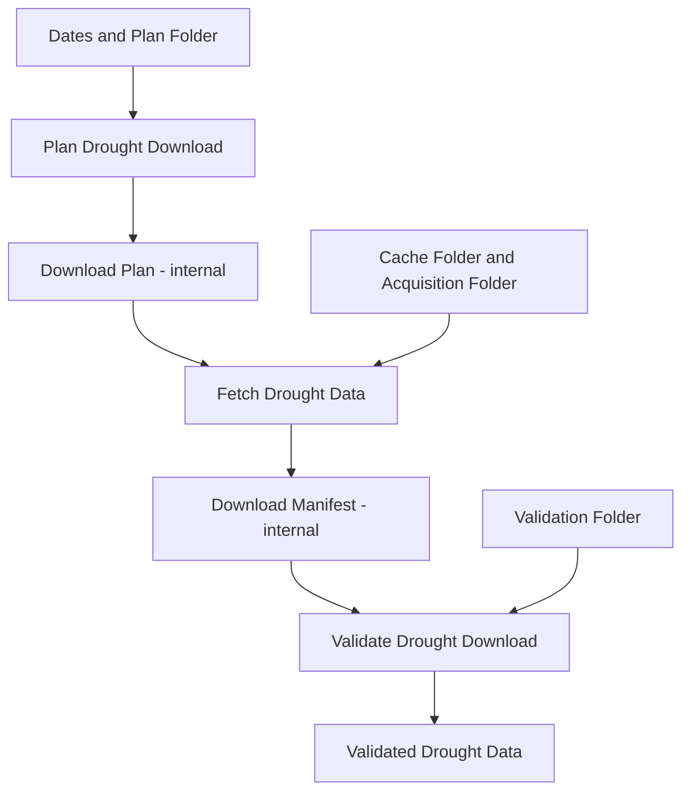
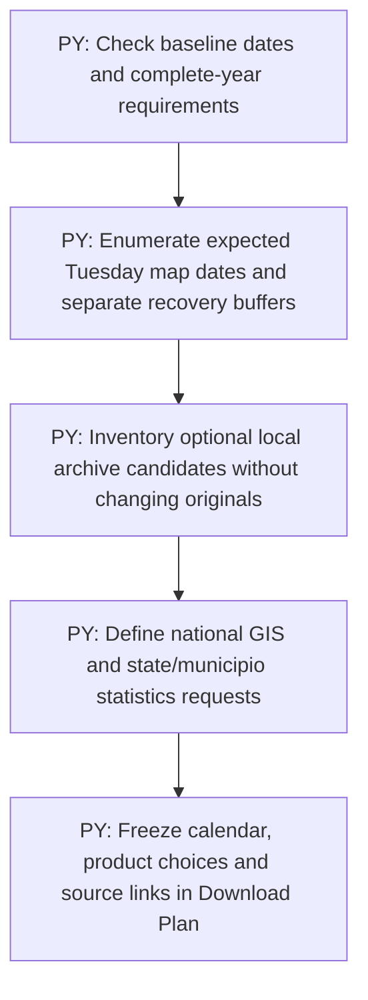
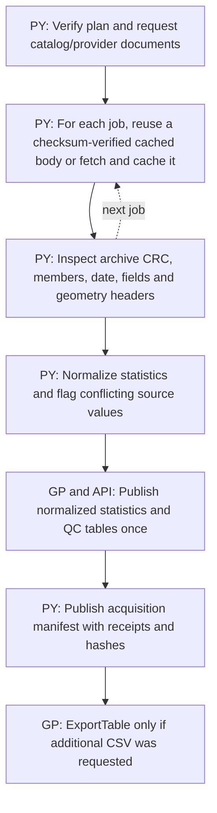
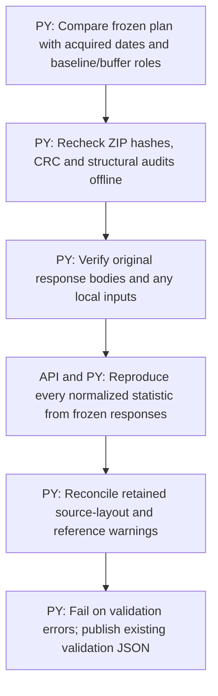
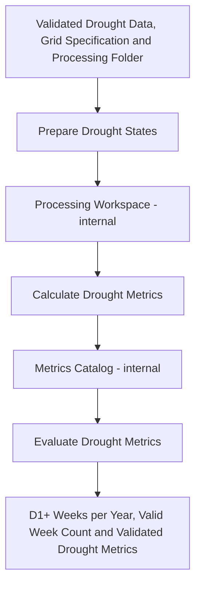
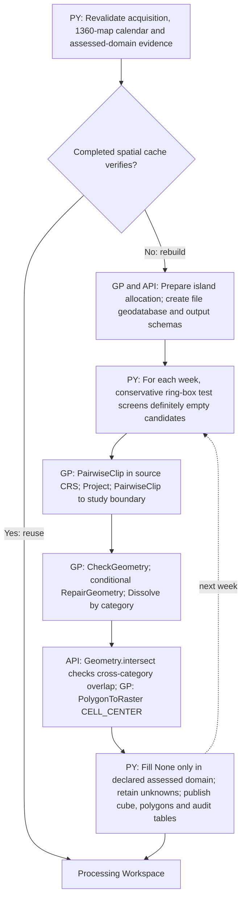
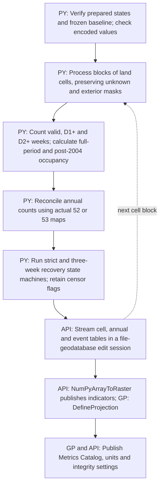
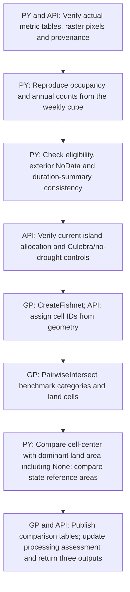

# Drought ModelBuilder setup

## Continuous-indicator processing model

The toolbox includes the saved **Drought_Process_USDM** model (internal **Name=ProcessDrought**) with **Prepare Drought States**, **Calculate Drought Metrics** and **Evaluate Drought Metrics**. The original acquisition `Model` item is preserved.

To use the saved workflow, double-click **Drought_Process_USDM** in Catalog. Set its three inputs: Validated Drought Data, Grid Specification and Processing Folder, using the paths below for this project. The three outputs are filled automatically. Click Run once; the model runs the linked stages in order. The canvas instructions below explain how to edit or reconstruct this setup.

| Prepare Drought States | Exact value |
|---|---|
| Validated Drought Data | `C:\Users\ALEJANDROSVEGANOGALE\Documents\Repos\PLAN6059-PR-Risks-SDSS\output\drought\reports\download_validation.json` |
| Grid Specification | `C:\Users\ALEJANDROSVEGANOGALE\Documents\Repos\PLAN6059-PR-Risks-SDSS\output\shared\grid\grid_spec.json` |
| Processing Folder | `C:\Users\ALEJANDROSVEGANOGALE\Documents\Repos\PLAN6059-PR-Risks-SDSS\output\drought\data` |
| Reuse Completed Cache | True; keep internal to the model |

In Calculate Drought Metrics, select the **Processing Workspace model variable** produced by Prepare Drought States. In Evaluate Drought Metrics, select the **Metrics Catalog model variable** produced by Calculate Drought Metrics. These connections establish the process dependencies; selecting existing datasets from disk does not.

### Make the model's input/output form (no execution needed)

Here, **model parameter** means an oval on the canvas that will appear as a field when someone opens the entire saved model from the toolbox. Setting this up does not calculate data and does not require running any tool. It is separate from the parameters inside each yellow Script Tool box.

1. After configuring the three boxes with OK, locate the input ovals currently named **download_validation.json**, **grid_spec.json** and **data**. Right-click each oval, choose **Rename**, and give them the names **Validated Drought Data**, **Grid Specification** and **Processing Folder**, respectively.
2. Right-click each of those three renamed input ovals and click **Parameter** so it is checked. A small **P** appears beside the oval. This is what making an input public, or “exposing” it, means.
3. Do the same **Parameter** action for the three final output ovals: **D1+ Weeks per Year**, **Valid Week Count** and **Validated Drought Metrics**. They can be model parameters before their datasets exist.
4. Leave **Processing Workspace** (which may display as drought_processing.gdb) and **Metrics Catalog** unchecked. They connect the stages internally. Do not mark the yellow process boxes as parameters.
5. On the ModelBuilder ribbon, open **Properties**, choose **Parameters**, and arrange the six rows in this order: Validated Drought Data; Grid Specification; Processing Folder; D1+ Weeks per Year; Valid Week Count; Validated Drought Metrics. The first three are inputs and the last three are outputs.
6. Click OK and use **Save on the ModelBuilder ribbon** to save the model itself. Saving the project alone is not a substitute. Auto Layout is optional if the current arrangement is already readable.

**Distinguish the folder input from the workspace output by its arrows:**

```text
Validated Drought Data (input file) ──┐
Grid Specification    (input file) ──┼─> Prepare Drought States
Processing Folder     (input folder)─┘           │
                                               v
                                 Processing Workspace (.gdb)
                                               │
                                               v
                                  Calculate Drought Metrics
```

Processing Folder goes **into Prepare** and its path ends in `\data`. Processing Workspace comes **out of Prepare**, goes into Calculate, and its path ends in `\drought_processing.gdb`. Keep only the folder input public. If the .gdb oval was accidentally renamed Processing Folder, rename it Processing Workspace first, then rename the actual incoming data oval Processing Folder.

The Properties → Parameters table must show **three inputs** (File, File, Folder) and **three outputs** (Raster Dataset, Raster Dataset, File). There should be no Workspace row and no input named data in that table. These type/direction checks are more reliable than counting six rows alone.

All Script Tool outputs remain Derived; that is a tool-definition setting, not something you need to change while marking the ovals. Confirm output survival during the later saved-model test.

### Run only after setup is complete

Use the entire model's Run command when testing the complete chain. Do not run only Evaluate Drought Metrics before Calculate Drought Metrics has successfully created its catalog. Avoid running the CLI and ModelBuilder simultaneously against the same Processing Folder.

`ERROR 000732: Metrics Catalog ... does not exist` means the expected table has not been created at that location. It does not mean model parameters need to be made public first. Check the Calculate Drought Metrics messages and its preceding preparation result. The Evaluate input must be the **Metrics Catalog oval connected from Calculate**, not a manually selected path from an earlier run. Do not create an empty table to satisfy the error. On this installation, the original compact, one-line Python entrypoint caused ArcGIS to skip the script body; the adapters now use the conventional multiline entrypoint used by the fetch tools.

The full baseline is fixed at 2000-2025, with 1,357 maps and three end buffers. No professor-sample input or new download is required. Processing needs ArcGIS Pro Advanced; no additional modeling dependencies are installed.

```powershell
& 'C:/Program Files/ArcGIS/Pro/bin/Python/envs/arcgispro-py3/python.exe' drought.py process
```

Individual commands are `prepare-states`, `metrics` and `evaluate`; use `--help` for path arguments. `prepare-states --refresh-spatial` rebuilds spatial products while retaining the original download cache. Default reuse checks the completed cube, prepared polygons, source/grid identities and preparation code. Metric-code changes require recalculating metrics rather than rebuilding spatial states.

Results live in `output/drought/data/drought_processing.gdb` and `drought_weekly_cube.npz`. The Metrics Catalog lists indicator datasets and units; annual/cell/event tables retain underlying counts and censoring. None=0 differs from D0=1 in the cube, and unknown=255 is excluded from every threshold predicate. Only cells with all 1,357 baseline observations receive full-period indicators. The coverage raster counts valid assessments and is not a hazard score.

The population-focused course index covers mainland PR, Vieques and Culebra. Mona is outside its scope. Its sparse observations remain in the data audit, and its full-period indicators remain NoData as an expected edge case; this does not block the index workflow.

Read the **processing** section of the existing validation JSON for the processing assessment. Its top-level checks and `passed` describe acquisition, and its legacy `ready_for_rasterization=False` states that acquisition alone does not establish spatial readiness. Running acquisition validation recreates the report and removes the processing section; rerun processing to obtain the current handoff. Scientific coverage assumptions and final ranking decisions remain separate from computational validation.

After both drought models are saved, refresh the one drought PNG with:

```text
python tools/export_model_diagram.py --toolbox DroughtRisk_Model_Toolbox.atbx --output figures/drought_modelbuilder_graph --all-models --title "Drought workflows" --footer "Continuous indicators; final classification remains pending"
```

## Existing acquisition model

Open `DroughtRisk_Model_Toolbox.atbx`; alias `droughtprobe`. Retain the saved model's internal name **Model** and label **Drought_Fetch_USDM**. Its three stages are Plan Drought Download → Fetch Drought Data → Validate Drought Download.

## Exact dialog values

| Plan Drought Download | Value |
|---|---|
| Start Date | 1/1/2000 |
| End Date | 12/31/2025 |
| Plan Folder | `C:/Users/ALEJANDROSVEGANOGALE/Documents/Repos/PLAN6059-PR-Risks-SDSS/output/drought/plan` |
| Local Archive Folder | **Blank**, optional individual-tool capability only |
| Include Municipio Statistics | True |
| Recovery Buffer Weeks | 3 |
| Mode | Baseline |

| Fetch Drought Data | Value |
|---|---|
| Download Plan | Connect Plan Drought Download → Download Plan |
| Cache Folder | `C:/Users/ALEJANDROSVEGANOGALE/Documents/Repos/PLAN6059-PR-Risks-SDSS/output/drought/cache` |
| Acquisition Folder | `C:/Users/ALEJANDROSVEGANOGALE/Documents/Repos/PLAN6059-PR-Risks-SDSS/output/drought/data` |
| Resume | True |
| Export CSV | False |

| Validate Drought Download | Value |
|---|---|
| Download Manifest | Connect Fetch Drought Data → Download Manifest |
| Validation Folder | `C:/Users/ALEJANDROSVEGANOGALE/Documents/Repos/PLAN6059-PR-Risks-SDSS/output/drought/reports` |

## Lean saved graph

Keep exactly three process boxes. When replacing the old graph, remove old process/variable nodes from the canvas and add the refreshed Script Tools, keeping the existing model item. Make only these public inputs, in order: **Start Date, End Date, Plan Folder, Cache Folder, Acquisition Folder, Validation Folder**. Make the final output **Validated Drought Data** public. No local-archive node, year-specific input, unused `acquire`, duplicate `(2)` labels, Boolean, statistics or QC outputs should remain.

Download Plan and Download Manifest remain internal connectors. All Script Tool outputs are declared **Derived**; ArcGIS Pro exempts derived outputs from intermediate-data deletion and does not offer the Intermediate toggle for them. Retain that type and confirm the files survive a saved-model run. Give folder variables the labels above and control public order under Model Properties → Parameters. Run Validate, Auto Layout, Save. The final validation JSON references the acquisition manifest; future preparation consumes that handoff and discovers tables/raw archives through the manifest.

The plan contains its calendar in JSON. Fetch publishes `drought_acquisition.gdb/statistics` and `acquisition_qc`, plus `download_manifest.json`. Tables are not separate ModelBuilder outputs. CSV export is optional/off by default with ArcGIS; ordinary Python uses CSV as its primary table format. Validation reproduces table values from frozen JSON responses and preserves reference warnings rather than renormalizing them.

## Normal execution

Run the saved model from the Geoprocessing pane. The baseline is **1,357 weeks + 3 end buffers**, **654,160 normalized rows**, and **231 retained reference warnings** for the frozen snapshot. Buffers are separate from the 26-year baseline. A warm-cache run verifies bytes and avoids network requests. The first run without the professor sample fetched the three buffer archives once; historical archives were reused. Keep `output/drought/cache` for subsequent runs.

From ArcGIS Python: `python drought.py run --arcpy-tables --offline`. Remove `--offline` to allow missing downloads. Ordinary Python: `python drought.py run --offline` (primary CSV, no GDB). Optional `--local-archive-folder` is available to individual planning/CLI use, not a public saved-model input. Do not include 2026 in a historical indicator denominator.

The three acquisition stages do not calculate drought hazard. [Processing design](drought_processing_plan.md) explains assessed-domain checks, weekly spatial states, frequency/duration and later ranking. Acquisition passing does not certify raster readiness.

Rebuild Script Tools with `python tools/build_toolbox.py --overwrite --verify` in ArcGIS Python with Pro closed. Use the GUI for ordinary graph/interface changes; rebuilding definitions alone does not reconnect a saved graph. Explicitly authorized programmatic repairs must synchronize logical/diagram contracts and pass actual saved-model execution. Render both saved graphs with the `--all-models` command in the processing section above. See [diagram](../figures/drought_modelbuilder_graph.png).

## Workflow diagrams and tool algorithms

These diagrams summarize current code and connections, with supporting folders/tables grouped. **GP** = an actual ArcGIS geoprocessing tool; **API** = ArcPy cursors, geometry or raster/array operations; **PY** = Python/NumPy logic. GUI comparisons are conceptual where stated. Open each tool for its algorithm; these are not native canvas screenshots.

### Drought acquisition overview


<details>
<summary>Inside Plan Drought Download</summary>



| Implementation | What happens |
|---|---|
| Actual ArcGIS tools | No analysis tool. The Script Tool adapter uses ArcPy parameters/messages; planning and ZIP inventory are ordinary Python. |
| GUI comparison | ModelBuilder iteration can express a loop, but this planner uses calendar/HTTP request specifications rather than GIS analysis. Local archive reuse is optional and absent from the saved public form. |

</details>

<details>
<summary>Inside Fetch Drought Data</summary>



| Implementation | What happens |
|---|---|
| Actual ArcGIS tools | CreateFileGDB, CreateTable, AddFields and Delete through table_writer; ExportTable only for optional CSV. Default ArcGIS execution writes tables without duplicate CSV. |
| GUI comparison | Web downloads, content-addressed cache resolution and response validation have no direct analysis-tool equivalent. Table publication is ordinary ArcGIS data management. |

</details>

<details>
<summary>Inside Validate Drought Download</summary>



| Implementation | What happens |
|---|---|
| Actual ArcGIS tools | No analysis tool. SearchCursor/Describe/ListFields are used by normalized table readers when data are in a geodatabase. |
| GUI comparison | Manual table inspection is possible, but it does not replace full response-to-table reconciliation. Acquisition passing alone does not approve rasterization or ranking. |

</details>

### Drought processing overview


<details>
<summary>Inside Prepare Drought States</summary>



| Implementation | What happens |
|---|---|
| Actual ArcGIS tools | CreateFileGDB, CreateFeatureclass, AddField/AddFields, GetCount, PairwiseClip, Project, CheckGeometry, conditional RepairGeometry, Dissolve, PolygonToRaster and Delete. Overlap checks here use Geometry.intersect, not the Pairwise Intersect tool. |
| GUI comparison | Spatial operations have direct GUI counterparts. Coverage-based None filling, archive screening and complete-cache verification are custom. Missing coverage must not become None or zero. |

</details>

<details>
<summary>Inside Calculate Drought Metrics</summary>



| Implementation | What happens |
|---|---|
| Actual ArcGIS tools | DefineProjection and table helper calls CreateTable, AddFields and Delete. Editor, cursors and raster/array conversion are APIs. |
| GUI comparison | Threshold occupancy resembles conditional raster algebra plus Cell Statistics. Event recovery, buffer handling and censoring have no single equivalent GUI analysis tool. The implementation uses the cube, not thousands of weekly raster files. |

</details>

<details>
<summary>Inside Evaluate Drought Metrics</summary>



| Implementation | What happens |
|---|---|
| Actual ArcGIS tools | CreateFileGDB, CreateFeatureclass, AddField/AddFields, CreateFishnet, PairwiseIntersect, PolygonToRaster (island check), CreateTable and Delete through helpers. |
| GUI comparison | Fishnet/intersection are direct counterparts. Dominant-area selection and higher-category exact ties are calculated from intersection areas; a Polygon To Raster priority is not a substitute for that rule. VALIDATED is computational consistency, not approval of rank thresholds. |

</details>
