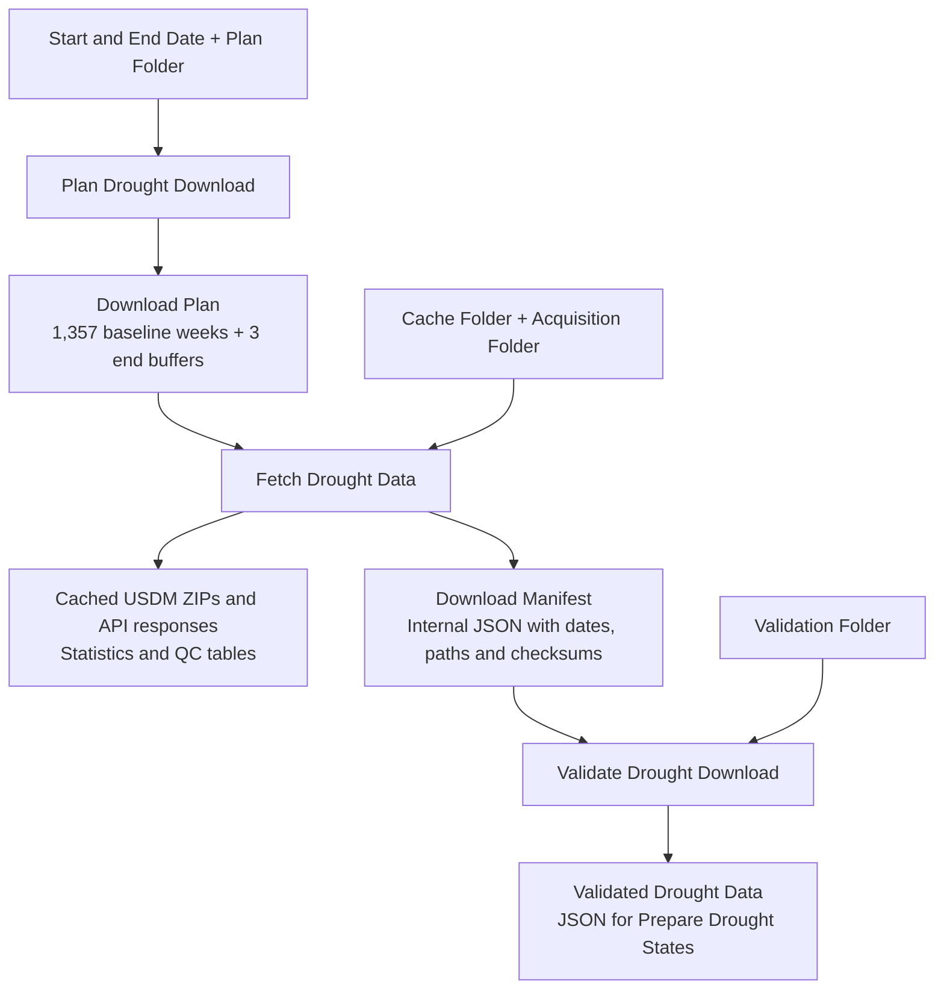
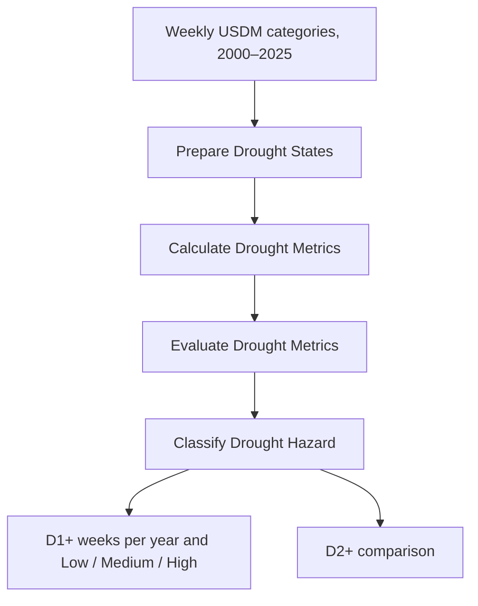

# Puerto Rico drought: literature review and processing design

The workflow prepares weekly spatial states, calculates occupancy, severity and event statistics for D1+ and D2+, and evaluates the results. The classifier fits a separate set of three course classes to each severity threshold. See the [ModelBuilder setup](drought_modelbuilder_setup.md) for exact parameters.

The [classification report](drought_classification_report.md) documents the per-layer course breaks, class counts, clipped land areas and transition matrices.

## Discussing the saved drought acquisition model

**Drought_Fetch_USDM** freezes the expected weekly calendar, retrieves the source archives and reference statistics, and verifies the saved result offline. The three tools pass a plan and manifest between them. **Validated Drought Data** is the one public output. See the [setup guide](drought_modelbuilder_setup.md#drought-acquisition-overview) for the full tool diagrams and parameter values.

[Download the drought acquisition diagram as a PNG](../figures/discussion/drought_acquisition.png).

| Stage | What to point out in the discussion |
| --- | --- |
| **Plan Drought Download** | The form uses **January 1, 2000 through December 31, 2025**. The Python planner enumerates expected Tuesday map dates and labels baseline versus buffer weeks. The source record starts on **January 4, 2000**. Three January 2026 maps provide recovery context for events near the end of 2025. Their buffer label keeps them outside the historical denominator. |
| **Fetch Drought Data** | Retrieves weekly **national merged-class USDM polygon ZIPs** and Puerto Rico reference statistics. Those include territory-wide cumulative and exact-category area percentages, the Drought Severity and Coverage Index (DSCI), and exact-category area percentages for **78 municipios**. Resume reuses cached responses after checksum verification. ArcPy writes the normalized statistics and quality-control tables to the acquisition geodatabase, and the manifest records the original response locations and hashes. |
| **Validate Drought Download** | Rechecks archive integrity, map dates, baseline/buffer roles and actual normalized values against the saved source responses. The verified run contains **1,357 baseline maps + 3 end buffers**, **654,160 statistics rows** and **231 retained warnings** covering source layout and reference disagreements. The final JSON (`download_validation.json`) links to the acquisition manifest and feeds **Prepare Drought States**. |

- **Why keep both polygons and statistics?** The polygons locate drought categories. The API percentages summarize areas and provide a comparison for quality checks. The existing Culebra example shows why that matters. For two August 2015 weeks the API reports both None and D2 as 100%, while the polygon check locates the Culebra control point in D2.
- **What happens on a map with no Puerto Rico drought polygons?** The acquisition model still requires that week's archive. An empty Puerto Rico clip can be a valid week. The processing model assigns None only where assessment coverage is supported, and preserves unknown coverage separately.
- **Where does hazard processing start?** The next saved model, **Drought_Process_USDM**, combines the validation JSON with the shared grid. It clips and rasterizes weekly polygons, then calculates D1+ weeks per year, durations and other indicators. Those results support the separate 1/3/5 classification discussion.

## Discussing the saved drought processing model

**Drought_Process_USDM** uses the validated acquisition handoff, the shared grid specification and a processing folder. The saved model turns weekly polygons into aligned drought states, calculates continuous indicators and checks the published results. See the [drought setup guide](drought_modelbuilder_setup.md#drought-processing-overview) for the tool algorithms and parameter values.

[Download the drought processing diagram as a PNG](../figures/discussion/drought_processing.png).

| Stage | What to point out in the discussion |
| --- | --- |
| **Prepare Drought States** | Reuses verified spatial products when available. A fresh build uses **Pairwise Clip**, **Project**, **Dissolve** and **Polygon To Raster** to place weekly categories on the shared grid. The weekly cube keeps None, D0 and unknown as distinct values. |
| **Calculate Drought Metrics** | Counts D1+ and D2+ observations and divides by **26 years** for cells with all **1,357 baseline weeks**. It calculates events for each threshold with one and three weeks to confirm recovery. January 2026 buffer maps can confirm the end of an event that began during 2000–2025. |
| **Evaluate Drought Metrics** | Checks indicator values and annual counts against the cube, including coverage and NoData. It uses **Create Fishnet** and **Pairwise Intersect** to compare cell-center and dominant land-area assignments for six comparison weeks. It returns the indicator raster, the coverage raster and the updated validation JSON. |

Put **D1+ Weeks per Year** beside **Valid Week Count** in the discussion. Together they show where drought occurred more often and which cells have enough observations for that comparison. The [drought classification report](drought_classification_report.md) gives the final 1/3/5 thresholds and the measured D2+ comparison.

## Implemented processing contract

The three processing tools are **Prepare Drought States → Calculate Drought Metrics → Evaluate Drought Metrics**. They use the complete cached cohort: 1,357 baseline weeks and three end buffers. There is no forecasting or longer SPI/SPEI branch in this implementation. All spatial work uses the existing EPSG:32161, 250 m, 1,140-column by 267-row reference grid.

`drought_processing.gdb` holds dated PR drought polygons, original-record lineage, weekly geometry/source audits, an island/date assessment ledger, settings, normalized cell/annual/event tables and an indicator catalog. One `drought_weekly_cube.npz` holds uint8 states, dates, roles and island allocation. Individual weekly rasters and duplicate CSV exports are not retained. A compressed cube is a processing cache, not a new native meteorological dataset.

The first complete spatial build processed all 1,360 maps in about **117 minutes** on this workstation; the compressed cube occupies **4.55 MiB**. The conservative screen avoided GIS clipping for 607 weeks. The metric tool then completed in **4 minutes 39 seconds**. These are measured local runtimes, not guarantees for another machine. Ordinary reruns verify and reuse the completed spatial cache.

The saved `Drought_Process_USDM` model passed all three stages in **6 minutes 39 seconds** with the verified spatial cache. Its two public rasters, catalog and internal datasets survived model completion. The geodatabase contains 144,085 cell rows, 3,746,210 annual rows, **2,413,234 event rows** across both severity thresholds and both recovery rules, and **19 cataloged indicator rasters**. The classification tool writes the D1+ score and class TIFFs and keeps the D2+ comparison in that geodatabase.

| Island | Study cells | Complete 1,357-week cells |
|---|---:|---:|
| Mainland | 140,488 | 140,488 |
| Vieques | 2,416 | 2,416 |
| Culebra | 421 | 421 |
| Mona (audit only; outside index scope) | 760 | 0 |

Across the 143,325 eligible cells covering the inhabited study islands, `W_D1` ranges from **0 to 8.96 weeks/year**, with a cell mean of **2.57**. The six comparison weeks show **99.960-100%** agreement between cell-center and dominant-land-area assignment; the largest difference affects 57 cells, representing about 2.78 km² of land. Polygon-versus-API cumulative-area differences reach about **1.53 percentage points**. These comparisons retain the reference warnings and quantify source/mask differences; they neither establish independent drought skill nor settle sensitivity across all weeks.

Preparation inspects the actual source CRS, clips original national geometries before projection, dissolves by date/category and checks geometry and cross-category overlap. Repairs occur only in working copies; feature loss stops the workflow. Numerical overlap tolerance is 0.000001 m²; larger cross-category overlaps require source review. Original ZIPs, hashes, receipts and API disagreements remain unchanged. A conservative NumPy ring-box screen skips GIS work only for definitely empty regional candidates; it does not reconstruct rings or infer assessment coverage.

The population-focused course index covers mainland PR, Vieques and Culebra; Mona is outside the index scope. The declared assessment policy for the study islands uses the provider's [weekly PR product scope](https://droughtmonitor.unl.edu/Maps/MapArchive/MapAreas.aspx) and complete municipio/date chronology. It is a documented interpretation of product coverage, not evidence inferred from drought occurrence or API None percentages. The Natural Earth coast remains generalized. Mona's sparse observations are retained only for the shared-grid data audit: mapped categories remain observed, other observations remain unknown, and full-period indicators remain NoData. This is an expected out-of-scope edge case, not a limitation or blocker for the population-focused index.

The primary raster is `W_D1 = N_D1 / 26`. Integer eligible D1 counts and valid counts accompany it; supporting products include D2 occupancy, temporal ordinal burden, post-2004 occupancy and both event-rule summaries. Partial observed counts remain in the normalized cell table. Annual rows preserve each year's actual 52/53-map count, rather than assuming 52 observations. Event counts describe observed episodes intersecting the baseline divided by 26; they are not annual drought probabilities. Buffer-only events are excluded.

Three-week events end at the last D1+ observation before three consecutive D0/None observations. Their confirmation date is stored separately. Short internal recovery dips remain within the event span, but trailing confirmation weeks do not. Unknown observations split support and generate censor flags. At the start of observation, onset remains left-censored until the rule's required calm streak has been observed. Strict runs use one recovery observation. Both rules retain observed span, baseline span, baseline D1 count, peak encoded class and left/right censor flags. Completed-duration medians/maxima summarize baseline spans of uncensored, confirmed events; censored observed spans are separate diagnostics. No-event counts are zero; undefined duration statistics remain null/NoData.

Evaluation reads actual raster pixels and normalized tables, checks all annual rows against the cube, and checks the known Culebra controls. Six in-cohort weeks support state reference-area and cell-assignment comparisons, including 2026-01-06 only as a buffer. Exact dominant-category land-area assignment includes the None remainder; equal-area ties favor the higher category. A Polygon To Raster priority field is not used to emulate area-only tie breaking, because it can override area dominance. State comparisons are diagnostic because source coastlines, domain coverage and area methods differ. No new municipio boundary download is required; full 78-municipio spatial reconciliation remains deferred.

The existing drought validation JSON receives a separately scoped `processing` assessment. Acquisition `passed` is not processing approval. Processing `VALIDATED` describes computational consistency and explicit coverage exclusions; it does not establish independent drought skill, approve 1/3/5 breaks or eliminate coastal uncertainty. Changes to map dates, roles, archive contents or the grid invalidate the prepared cache; a repeated fetch with identical maps and a new receipt timestamp does not. Classification uses integer counts and eligible coverage, preserving unknown cells as NoData.

### Corrections to the supplied implementation blueprint

- The full read-only cache scan found **607 empty-envelope candidates and 753 active candidates**, rather than 850+ empty weeks. Screening is conservative; a positive bounding-box test is not proof of a PR drought intersection.
- The complete cube is **413,956,800 bytes (394.78 MiB) uncompressed**. Compressed size, runtime and reload speed are measured outcomes, not the report's guaranteed 4 MB/0.2-second/9-minute claims.
- No ring reconstruction or new GeoParquet dependency is needed for this round. Original GIS geometry handles shells and holes.
- Recovery confirms an event's last D1+ week; it does not automatically assign termination to late 2025 or append three weeks to duration.
- The 2014-2016 spatial pattern supports inspection against credible references; expected east/south severity is not an independent-validation criterion.
- The classification stage fits the three classes, compares alternative rules and calculates class-transition areas.

## Drought calculations and geodatabase layers

1. Clip dated USDM polygons to the study area, project onto the shared grid and assign the category at each cell center. The weekly cube stores category codes 0 for None, 1 for D0, 2–5 for D1–D4 and 255 for unknown. Set None only where the week's assessed domain supports it.
2. Count qualifying baseline weeks and divide by 26 to obtain weeks/year. A cell needs 1,357 valid baseline weeks for these full-period scores. Count runs of qualifying weeks separately. Each event begins at a qualifying week and ends at the last qualifying week before one or three below-threshold observations confirm recovery. A short dip inside an event counts toward the elapsed span. Exclude trailing recovery weeks from the span. The January 2026 buffer can confirm recovery, and gaps in assessed coverage produce censor flags.
3. Fit three Natural Breaks (Jenks) classes to the valid D1+ counts. Repeat independently for D2+. Store the exact count cuts and class summaries in the validation report and use **Reclassify** to write integer 1/3/5 rasters.

| Layer or table in `drought_processing.gdb` | Definition and units |
| --- | --- |
| `N_VALID` | Number of valid baseline weekly assessments. |
| `N_D1`, `N_D2` | Number of weeks at D1 or worse, or D2 or worse, in 2000–2025. |
| `W_D1`, `W_D2` | Corresponding count divided by 26, in weeks/year. `RiskDrought_score250.tif` uses D1+ and `D2_score_250` uses D2+. |
| `W_D1_2004` | D1+ weeks/year in 2004–2025, using 1,148 qualifying assessment dates as the coverage requirement and 22 years as the rate denominator. |
| `F_D1` in `cell_metrics` | D1+ count divided by 1,357 baseline weeks and multiplied by 100, in percent of assessed weeks. |
| `ORDINAL_BURDEN` | Mean baseline encoded state × 100, an ordinal index from 0 to 500. |
| `EVENT_RATE_1W`, `EVENT_RATE_3W`, `EVENT_RATE_D2_1W`, `EVENT_RATE_D2_3W` | Observed qualifying events intersecting the baseline divided by 26, in events/year. Suffixes indicate one or three weeks to confirm recovery. Without `D2` the threshold is D1+. |
| `MEDIAN_SPAN_*`, `MAX_SPAN_*` | Median or maximum baseline span of completed, uncensored events, in weeks. The suffixes follow the event-rate convention. |
| `RiskDrought_rank250.tif`, `D2_rank_250` | Three-class D1+ course TIFF (in the data folder) and D2+ comparison (in the geodatabase). Each uses its own fitted count cuts. |
| `cell_metrics`, `annual_cell_metrics`, `drought_events`, `metric_catalog` | One row per cell, cell/year, or event, plus paths and units for the indicator rasters. Event fields record threshold, recovery rule, timing, qualifying weeks and censor flags. |

## 1. Recommended scope and observation period

Use **weekly USDM polygons for 2000-01-04 through 2025-12-30** as the first drought-hazard series. Live PR statistics and the GIS directory each contain **1,357 matching Tuesday dates**, representing 26 calendar-year cohorts. Use the 2026 professor sample for ingestion tests, rather than mixing a partial year into the historical indicator.

The hurricane preparation covers seasons **1955-2025**. USDM cannot supply those 71 years: a direct API request beginning in 1955 returned no PR observations before January 4, 2000. Preserve different documented periods for the initial hazard layers. Later, evaluate a common-period 2000-2025 hurricane sensitivity product, explicitly distinguishing hurricane seasons from drought map-calendar dates. The course's ordinal sum does not require pretending that the two hazards share an observation denominator.

**If matching 1955-2025 becomes essential**, develop a separate monthly SPI/SPEI branch using a single consistent climate source across that entire period. Do not splice pre-2000 SPEI to post-2000 USDM: they represent different indicators, temporal supports, and decision rules.

## 2. Evidence matrix

The first five entries are peer-reviewed journal articles; the Puerto Rico proceedings paper is additional regional context. This exceeds the course minimum of two research articles for Drought, but the class report still needs evidence for Hurricane Winds. Agency documents supplement research; they do not replace its required article count. Full citations follow the matrix.

| Study | Area, inputs and support | Indicator / threshold | Validation and limitation | Transfer to this project |
|---|---|---|---|---|
| Leeper et al. (2022), [10.1002/joc.7653](https://doi.org/10.1002/joc.7653) | US including PR, 2000-2019; 1,044 weekly USDM maps on a 5 km grid. | D1-or-worse event onset; termination requires three subsequent D0/None weeks. Short recovery gaps can remain within an event. Counts, duration and intensification. | A historical event climatology, not a PR loss model. Comparisons with other drought measures are not independent impact validation. | Strongest direct USDM event-method precedent. Compare its recovery rule with strict consecutive-week runs; retain censor flags. Its 5 km grid does not establish 250 m accuracy. |
| Carrão, Naumann & Barbosa (2016), [10.1016/j.gloenvcha.2016.04.012](https://doi.org/10.1016/j.gloenvcha.2016.04.012) | Global/subnational assessment; historical monthly precipitation deficits at 0.5 degrees; exposure and socioeconomic inputs at other supports. | Separate hazard, exposure and vulnerability; relative risk composite. | Internal robustness/composite comparisons and geographic plausibility; not an absolute loss scale. | Supports naming the USDM product a hazard layer and adding sector-specific exposure/vulnerability only in a later risk study. Do not copy global relative classes to PR. |
| Meza et al. (2020), [10.5194/nhess-20-695-2020](https://nhess.copernicus.org/articles/20/695/2020/) | Global agricultural systems, 1980-2016; hydrologic/crop-model hazards at 0.5 degrees; irrigated and rainfed exposure. | Irrigated frequency/severity uses streamflow/demand departures from calendar-month medians in 1986-2015; rainfed hazard uses a 10% AET/PET reduction relative to its reference mean. | Sensitivity and impact-record comparisons; national vulnerability and incomplete impact records limit validation. | Demonstrates why agricultural risk needs crop/water-system information. Its thresholds and model inputs cannot be inferred from DM polygons. |
| Vicente-Serrano, Beguería & López-Moreno (2010), [10.1175/2009JCLI2909.1](https://doi.org/10.1175/2009JCLI2909.1) | Observatories with different climates; precipitation and temperature/PET inputs; multiple accumulation periods. | SPEI standardizes accumulated precipitation-minus-PET; compares with SPI and sc-PDSI. No universal PR 1/3/5 hazard scale. | Cross-index comparisons and warming experiments; source/PET choice still matters. | Method foundation for an independently computed longer-baseline climate-index branch. Define scale and calibration period before estimating event statistics. |
| Beguería et al. (2014), [10.1002/joc.3887](https://doi.org/10.1002/joc.3887) | Observational and global gridded climate series; method study rather than a PR mapping resolution. | SPEI fitting, ET methods and temporal weighting; recommends unbiased probability-weighted moments for fitting. | Shows sensitivity to ET formulation; not independent validation of a particular PR hazard map. | Requires pinned PET/fitting methods and sensitivity checks; discourages treating every SPEI implementation as interchangeable. |
| Sorí et al. (2021), [10.3390/ecas2021-10335](https://www.mdpi.com/2673-4931/8/1/40), **proceedings paper** | Mainland PR, 1950-2019; Daymet V4 precipitation/temperature, 1 km; SPEI-1. | Spatial drought-category frequencies, including SPEI-1 <= -1; episode duration, severity and peak. | Compared with documented historical episodes; one-month scale and mainland scope constrain transfer. | Regional precedent for a longer climate-index series. Do not assume its results validate other islands or resolve every drought timescale. |

### Puerto Rico planning precedent

The **2020 CDBG-MIT public-comment draft**, printed pp. 53-54, maps average annual drought weeks from USDM 2000-2019 on 0.5-square-mile hexagons. It uses five classes, with boundaries around 1, 3, 5 and 7 weeks/year. Its description does **not clearly identify the minimum DM category counted**. This supports investigating an annual-weeks indicator, but not copying its thresholds as a validated D1-based 1/3/5 rule. It is a planning reference, not another peer-reviewed article. [PR Department of Housing draft, Figure 24](https://recuperacion.pr.gov/wp-content/uploads/2020/09/CDBG_MIT_ACTION_PLAN_FULL_DRAFT_EN_2020_09_20_FOR_PUBLIC_COMMENT-Reviewed-Sept21.pdf)

## 3. What USDM measures and what the sample does not supply

USDM categories blend indicators and expert assessment. **D0 is abnormally dry; D1-D4 are drought categories.** Drought-category maps do not supply all underlying rainfall, soil moisture, streamflow or SPI/SPEI observations, and a DM polygon is not a quantified loss. Keep the optional short/long-term impact information separate; the merged sample's `DM` field does not contain it. The classification table's indicator percentiles describe category interpretation, not the annual probability of a mapped drought at a location. [UNL classification](https://droughtmonitor.unl.edu/About/AbouttheData/DroughtClassification.aspx), [tutorial](https://drought.unl.edu/Education/Tutorials/Usdm.aspx)

For the course, recommend **drought hazard ranking** as the product name. A later agricultural-risk study would need crops, irrigation and water availability; a water-supply study would need service areas, reservoirs, source catchments and demand. Local residence inside a polygon does not fully describe a person's water-supply exposure. UNL population statistics assume an even population distribution within counties/municipios and have demographic and boundary limitations; retain them as contextual exposure estimates, not cell-level damage or independently observed counts. [UNL population methodology](https://droughtmonitor.unl.edu/About/AbouttheData/PopulationStatistics.aspx)

## 4. Prepare a valid weekly series before summarizing

The following **project design choices** govern the implemented weekly series.

1. Preserve the weekly ZIPs and metadata; add `MAP_DATE`, source hash, original CRS, retrieval date, and preparation status. Dates in filenames, effective map dates, metadata creation dates and Thursday release dates are distinct.
2. Check each file's fields/geometry. Normalize literal `DM` values 0-4; missing/unknown DM is an error to investigate. Verify that the merged product contains exact, non-overlapping classes. If a different source uses nested threshold polygons, convert it explicitly to exact categories; never sum overlapping class areas.
3. Clip a working copy around PR in the source CRS before projecting large national multipart geometries. Project the subset to EPSG:32161 with a recorded transformation; recompute areas. Preserve repairs and area/geometry change diagnostics.
4. Establish an **assessed-domain ledger by date and island**, independently of the union of drought polygons. Within a verified assessed domain and a successfully acquired week, land outside D0-D4 polygons can be None. A missing ZIP, unsupported island, or unexplained coverage gap is unknown. Neither the hurricane land mask nor the union of places ever in drought proves assessment coverage. Test mainland, Vieques and Culebra for every historical period. For out-of-scope Mona, retain mapped observations and unknowns in the audit without requiring complete coverage for this index.
5. Reuse the shared 250 m grid's CRS, origin, extent, rows, columns and land mask. Rasterize exact classes with **CELL_CENTER** for the first temporal prototype. Compare cell-center and area-fraction assignments on boundary-sensitive weeks before final selection. Do not interpolate DM classes with bilinear/cubic methods.
6. Use a distinct computational encoding: **None=0, D0=1, D1=2, D2=3, D3=4, D4=5; unknown=255/NoData**. Preserve literal raw DM separately. Thus source `DM=0` is D0, not None; D1-or-worse means encoded value at least 2.
7. Build an explicit expected-date calendar. A missing week is not a recovery week, a drought-free week, or a value to forward-fill. Default final-ranking eligibility requires all **1,357 valid map observations** at the cell; retain partial-coverage summaries as diagnostics.

USDM describes broad, transitional conditions. UNL reports that pre-2004 shapefiles were digitized from images, with approximately four-mile horizontal error in preliminary comparisons. Test **2004-2025** as a sensitivity period. The 250 m computational grid cannot remove that historical uncertainty or infer local terrain-driven drought differences. [UNL GIS metadata](https://droughtmonitor.unl.edu/DmData/Metadata.aspx)

## 5. Recommended multi-year indicators

Let `V(c,t)` identify a valid assessment at cell `c`, map date `t`, and `X(c,t)` be the encoding above. Use each map date once, even if its validity interval crosses a year. The initial cohort has **N=1,357 maps** and **Y=26 years**. These implemented indicators are informed by the evidence above.

### Primary: average annual weeks in D1 or worse

For a cell with complete coverage:

`N_D1(c) = sum_t 1[V(c,t)=1 and 2 <= X(c,t) <= 5]`

`W_D1(c) = N_D1(c) / 26`  (weekly map observations per year)

Also report `F_D1(c) = 100 * N_D1(c) / 1357`, the percentage of weekly maps in drought. These contain the same information under complete coverage; do not combine both as separate weighted risk factors. `W_D1` is **not an event count/year**, and `F_D1` is **not annual drought probability**. Do not divide by 71 or assume every year contains exactly 52 maps.

A valid cell with no D1 weeks has a real zero indicator; unsupported cells remain NoData. Store `N_VALID`, `N_EXPECTED`, coverage fraction, and per-year counts with every summary. Do not hide gaps by shrinking each cell's denominator and then claiming comparability with the full-period map.

### Supporting indicators

| Indicator | Purpose and interpretation |
|---|---|
| D2-or-worse occupancy | Implemented comparison with the primary D1 indicator; D3-specific occupancy remains a later option. |
| Number of events/year | Requires a declared recovery-gap rule; one persistent drought must not be counted once per week. |
| Median/maximum event duration and peak class | Separates persistence from frequency. Flag events truncated by record boundaries or unknown weeks. |
| Mean ordinal severity | Average encoded 0-5 value over valid weeks; an ordinal burden measure, not equal physical increments of water deficit. |
| Annual occupancy | Implemented valid/D1 counts for each calendar year; seasonal summaries remain a later option. |

For event analysis, evaluate the Leeper recovery definition above against strict runs. Retrieve up to three early-2026 recovery weeks **as a separate buffer** when needed to interpret late-2025 events; never add them to the 1,357-map indicator denominator. Events that start before reliable coverage or cannot be shown to terminate are censored.

### DSCI as a comparison measure

For an area and week, UNL defines `DSCI = sum(cumulative D0...D4 percentages)`, equivalently `1*p_D0 + 2*p_D1 + ... + 5*p_D4` using exact-category percentages. It ranges from **0 to 500** and includes abnormally dry conditions. A temporal mean keeps that range; a temporal sum depends on observation count and has a different meaning. UNL labels DSCI experimental and does not provide a universal multiyear risk classification. [UNL DSCI explanation](https://droughtmonitor.unl.edu/About/AbouttheData/DSCI.aspx)

A state DSCI time series cannot create within-island spatial contrasts. Reconstruct area-weighted DSCI from prepared polygons for QA, and compare a cell's **DSCI-style temporal ordinal burden** with `W_D1` as a sensitivity indicator. Label that cell calculation as our adaptation. Do not treat categorical D0-D4 percentages as cumulative, or add cumulative percentages with the 1-5 weights a second time. The [two observed source discrepancies](#culebra-explains-why-api-statistics-need-quality-flags) must remain visible.

## 6. Ranking design and scientific checks

No reviewed source establishes universal Low/Medium/High thresholds for the proposed 2000-2025 `W_D1` surface. USDM instantaneous D1-D4 categories cannot directly classify a multi-year week-count raster.

**Course rule.** Fit three Natural Breaks (Jenks) classes independently to D1+ and D2+ using the integer counts over the full eligible three-island domain. Each layer records its own two inclusive upper cuts. Equal counts stay together, observed zero falls in Low, and unknowns stay NoData. Use the score in weeks/year to compare how often drought actually occurred at the two thresholds. Quantile, Equal Interval and the 3/7-weeks rule remain numerical comparisons for D1+.

Before selecting final classes:

- Inspect the implemented state threshold-area comparisons for comparison weeks, accounting for different coastline masks and area methods. Full municipio spatial comparisons remain deferred. A match checks processing consistency, not independent drought skill.
- Compare the **2015 drought** and later well-documented events with rain/streamflow/reservoir observations and impact records where available. USDM already uses some such inputs; document dependence and avoid calling reused inputs independent validation.
- Compare recovery rules, D1/D2 thresholds, full versus 2004-onward periods, coastal cell assignment and alternate ranking. Publish a class-transition matrix and changed **land area**, plus rank agreement for continuous fields.
- Quantify coverage and boundary uncertainty for the inhabited study islands; use year/event block resampling for uncertainty rather than treating adjacent weekly maps as independent trials. With 26 years, avoid unsupported long-return-period estimates.
- Check exact 250 m alignment, final integer values only 1/3/5, distinct NoData, and NoData propagation in the eventual sum with Hurricane Winds. The summed ranks remain an ordinal screening index.

## 7. Longer historical branch: realistic options

| Option | Potential role | Gate before use |
|---|---|---|
| Daymet V4 R1 climate, **1 km**, PR starts **1950** | Preferred finer-support candidate to investigate for computing a consistent SPI/SPEI series spanning 1955-2025. | Confirm the actual 2025 PR files, island masks, units/calendar and version; evaluate station support. Daymet uses a special 365-day calendar, so monthly aggregation needs explicit leap-year handling. Source documentation, not a collection's headline dates, must prove all required PR years. [ORNL dataset](https://doi.org/10.3334/ORNLDAAC/2129) |
| SPEIbase, monthly **0.5 degrees** | Coarse, ready-made long-record comparison; repository describes coverage through 2025. At PR latitude 0.5 degrees is roughly 53 km east-west by 56 km north-south. | **Do not adopt published v2.6-2.12 blindly.** Maintainer documentation reports a PET day-to-month conversion defect; v2.13 code fixes it, but a corrected data release was still described as forthcoming. Verify corrected file/version/checksum and PR cells before evaluation. [Maintainer README](https://github.com/sbegueria/SPEIbase/blob/master/README.md), [issue 19](https://github.com/sbegueria/SPEIbase/issues/19) |
| ERA5-Land monthly climate, **0.1-degree** delivered grid, from **1950** | Alternative consistent climate source for a separately specified index. | Reanalysis is not local observation. Verify island land-mask coverage, accumulation units, PET method, release status and validation. CDS access/account configuration is a separate later task. [Copernicus catalogue](https://cds.climate.copernicus.eu/datasets/reanalysis-era5-land-monthly-means?tab=overview) |

For a computed branch, choose SPI-3/SPI-6 or SPEI-3/SPEI-6 for comparison, with SPEI-12 as a persistence option; these are candidates, not selected PR impact models. Freeze a defensible calibration period such as 1981-2010, fit calendar-month distributions using only that baseline, and record missing months, accumulation warm-up, PET formula and parameter fitting. Assess against USDM over the overlap without assuming their category boundaries are identical. Computing the index at its native climate support precedes 250 m alignment; resampling must not be advertised as new 250 m climate information.

## References: research articles

1. Leeper, R. D., Bilotta, R., Petersen, B., Stiles, C. J., Heim, R., Fuchs, B., Prat, O. P., Palecki, M., & Ansari, S. (2022). Characterizing U.S. drought over the past 20 years using the U.S. drought monitor. *International Journal of Climatology, 42*(12), 6616-6630. [DOI](https://doi.org/10.1002/joc.7653); [NOAA-hosted article](https://repository.library.noaa.gov/view/noaa/48743/noaa_48743_DS1.pdf).
2. Carrão, H., Naumann, G., & Barbosa, P. (2016). Mapping global patterns of drought risk: An empirical framework based on sub-national estimates of hazard, exposure and vulnerability. *Global Environmental Change, 39*, 108-124. [DOI](https://doi.org/10.1016/j.gloenvcha.2016.04.012); [repository article](https://ri.conicet.gov.ar/server/api/core/bitstreams/3e3cade0-f4b4-44cd-9cb4-aa3ce5221748/content).
3. Meza, I., Siebert, S., Döll, P., Kusche, J., Herbert, C., Eyshi Rezaei, E., Nouri, H., Gerdener, H., Popat, E., Frischen, J., Naumann, G., Vogt, J. V., Walz, Y., Sebesvari, Z., & Hagenlocher, M. (2020). Global-scale drought risk assessment for agricultural systems. *Natural Hazards and Earth System Sciences, 20*, 695-712. [DOI/article](https://doi.org/10.5194/nhess-20-695-2020).
4. Vicente-Serrano, S. M., Beguería, S., & López-Moreno, J. I. (2010). A multiscalar drought index sensitive to global warming: The standardized precipitation evapotranspiration index. *Journal of Climate, 23*(7), 1696-1718. [DOI](https://doi.org/10.1175/2009JCLI2909.1).
5. Beguería, S., Vicente-Serrano, S. M., Reig, F., & Latorre, B. (2014). Standardized precipitation evapotranspiration index (SPEI) revisited: parameter fitting, evapotranspiration models, tools, datasets and drought monitoring. *International Journal of Climatology, 34*(10), 3001-3023. [DOI](https://doi.org/10.1002/joc.3887).
6. Sorí, R., Méndez-Tejeda, R., Stojanovic, M., Fernández-Alvarez, J. C., Pérez-Alarcón, A., Nieto, R., & Gimeno, L. (2021). Spatio-temporal assessment of meteorological drought in Puerto Rico between 1950 and 2019. *Environmental Sciences Proceedings, 8*(1), 40. Proceedings contribution; [DOI](https://doi.org/10.3390/ecas2021-10335).

The [course guidelines](../references/SDSS%20Final%20Project%20Fall%202026.pdf) govern final grid/ranking and reporting requirements. The source register below retains the acquisition references.

## Acquisition contract and sample interpretation

The `_M` files are merged-class **weekly national** GIS polygons, not monthly maps. DM=0–4 represents D0–D4; the source does not contain a separate None polygon, SPI/SPEI, rainfall, exposure or vulnerability. The supplied 40-week 2026 sample remains unchanged for reference and is not a model input by default. Its dates are outside the historical indicator, except for the separately labeled recovery buffers.

Actual sample projection files specify WGS84 despite older/general metadata describing Albers. The processing model inspects each file's CRS, projects the clipped geometry and computes areas from the resulting shapes. It carries the map date from the checked archive and member identity.

The fetch tool reads the national weekly ZIP catalog and requests Puerto Rico statistics in annual chunks. It uses `Accept: application/json` for statistics and `*/*` for archives. It filters responses with overlapping validity intervals to the expected Tuesday dates, then sorts and deduplicates the records. The complete calendar check uses those dates and the saved ZIPs. Cache indexes can point to relocated objects while the original bodies, receipts and SHA-256 hashes are preserved.

The full cohort has 1,357 baseline maps (2000-01-04–2025-12-30), 3 end buffers, 654,160 normalized reference rows and 231 retained warnings. The unavailable pre-USDM start buffers require left-censoring flags. Buffer dates never enter the 26-year/1,357-week denominator. The GIS archive is about 1.53 GB compressed; keep one cache. Typed statistics/QC tables are primary in ArcGIS. Standard-Python execution uses CSV as its primary representation. Optional additional CSV export is off by default in ArcGIS. Validation reproduces actual retained table values from frozen API responses.

Use NDMC/UNL, USDA, NOAA and NASA attribution as required by the [provider permission statement](https://droughtmonitor.unl.edu/About/Permission.aspx); inspect the frozen statement in the acquisition manifest before distribution.

## Historical acquisition findings used by processing

### Historical records are not always one feature per class

**225 weekly archives** have multiple features for at least one DM value; these
occur in 2000-2012. One national file has **76 features**. This is a source-layout
finding, not proof of overlapping categories or corruption. Do not assume five
rows per file, interpret each feature as a separate drought event, or add
same-class geometries without resolving their spatial relationship.

**Implemented processing:** after clipping, the tool preserves source-record lineage,
checks geometry, dissolves polygons by **map date and DM**, and checks cross-category
overlap. Dissolving prevents duplicated same-class area from inflating area summaries.
The original ZIP remains available for audit.

### Culebra explains why API statistics need quality flags

The validated acquisition retains **231 warnings**:

- **225** multiple-DM-feature source-layout warnings.
- **4** categorical-total disagreements: the two previously observed PR records
  and two municipio records.
- **2** state cumulative-versus-categorical disagreements.

For **2015-08-04 and 2015-08-11**, Culebra (`72049`) reports both **None=100%** and
**D2=100%** in the categorical API response, totaling 200%. The spatial evaluation
places the Culebra control inside a **D2** polygon on both dates. The state-level
categorical totals also disagree on these dates. These observations justify
flagging reference data, but do not establish the underlying provider error's
cause.

**Implemented processing:** the spatial model derives category assignments from
the polygons and the documented assessment domain. The API records remain flagged
and available as reference diagnostics. The polygon evidence preserves the D2
observations at the Culebra control.

### Mona is present in historical drought geometry

The 2026 sample alone had no DM matches at the Mona control. The fetched 2015
files explicitly place it in **D0**. These sparse observations remain useful
for auditing source interpretation outside the population-focused index scope.
Raw `DM=0` means **D0**; it must not be mistaken for the separate None state.

**Audit treatment:** retain the island/date ledger rather than assigning a
blanket drought-free status from the 2026 sample or the union of drought polygons.
Mona has 0-39 observed baseline states per cell; its remaining states stay unknown.
This sparse coverage is expected for an island outside the people-focused index
and does not require resolution before proceeding with the study islands.

### A valid no-drought week can have an empty PR clip

The 2000-01-04 source is structurally valid and its state statistics report 100%
None. Its PR dry-category clip contains **zero features**. This is not a missing
ZIP. Conversely, an empty clip alone cannot certify an island's assessment
coverage.

**Encoding change:** only inside a verified assessed-land domain, and for a valid
acquired week, convert land outside all D0-D4 polygons to **None=0**. Keep unknown
coverage and ocean as NoData. Otherwise normal weeks would incorrectly disappear
from the denominator and break duration calculations.

## Earlier ArcPy rasterization feasibility experiment

A previous six-week feasibility experiment examined:

- 2000-01-04: early digitized/no-drought case.
- 2015-08-04 and 2015-08-11: known reference-statistic anomalies.
- 2012-10-16: the 76-feature national source-layout case.
- 2026-01-06 and 2026-08-04: professor-sample pilots.

Each was clipped, projected with the recorded **WGS_1984_(ITRF00)_To_NAD_1983**
transformation, checked for geometry problems and cross-category overlap, and
rasterized by CELL_CENTER onto the existing **EPSG:32161, 250 m, 1,140 x 267**
reference grid. These six projected PR samples had **zero reported geometry
issues and zero measured cross-category overlap**. Raster dimensions, cell size
and exterior NoData checks passed; source ZIP checksums were unchanged.

Diagnostic rasters use **D0=1, D1=2, D2=3, D3=4, D4=5**. Land without a source
dry-category polygon is deliberately **unresolved/NoData** in these diagnostics;
the experiment does not implement the final assessed-domain/None fill. Their
numbers encode drought categories; course hazard ranks are a separate later
transformation. They are not usable as complete weekly input states for a final
frequency surface.

## Current readiness

The complete weekly states, frequency/occupancy and both event-rule summaries
have passed the saved processing model's computational checks. Review the
continuous fields, recovery/period sensitivities and coverage assumptions before
choosing final Low/Medium/High thresholds. Mona is an expected out-of-scope audit
case and does not block that work.
Sector-specific risk or loss estimation still needs exposure and vulnerability
data beyond the USDM polygons.

## Three tools versus three scientific phases

The implemented **three-part acquisition model** is:

**Plan Drought Download -> Fetch Drought Data -> Validate Drought Download.**

The complete SDSS drought branch has three broader scientific phases:

1. **Acquire and audit:** the three tools above.
2. **Prepare weekly states and estimate historical hazard:** the implemented
   processing model calculates frequency/occupancy, event duration, peak class
   and coverage, then evaluates computational consistency and spatial sensitivity.
3. **Evaluate and classify the hazard indicator:** select/freeze the 1/3/5
   crosswalk, test an alternative, and integrate aligned ranked layers into the
   course screening index.

Thus frequency/duration calculation is already **hazard estimation**. A separate
physical wind-field-style drought reconstruction is not needed to interpret
USDM's published weekly classes. The third phase supplies justified ranking and
index integration; adding exposure/vulnerability for quantified risk would be
an additional, explicitly scoped model.

## Source register

All user-supplied references were accessed in this research. The dynamic map/form pages are contextual interfaces; the API and frozen archive index are the acquisition contracts.

| Reference | Role in the plan |
|---|---|
| [Puerto Rico current map](https://droughtmonitor.unl.edu/CurrentMap/StateDroughtMonitor.aspx?PR) | Visual/legend check; avoid scraping its dynamic controls for historical data. |
| [Web service information](https://droughtmonitor.unl.edu/DmData/DataDownload/WebServiceInfo.aspx) | API request patterns and geography/format selectors. |
| [Statistics by threshold](https://droughtmonitor.unl.edu/DmData/DataDownload/StatisticsbyThreshold.aspx) | Filtered diagnostic queries, not full chronology. |
| [DSCI download](https://droughtmonitor.unl.edu/DmData/DataDownload/DSCI.aspx) | Reference-series acquisition. |
| [Comprehensive statistics](https://droughtmonitor.unl.edu/DmData/DataDownload/ComprehensiveStatistics.aspx) | Unfiltered category/area series. |
| [Statistics explanation](https://droughtmonitor.unl.edu/About/AbouttheData/StatisticsExplanation.aspx) | Cumulative versus exact-category meanings; area versus population units. |
| [Population statistics](https://droughtmonitor.unl.edu/About/AbouttheData/PopulationStatistics.aspx) | Exposure-estimation assumptions and limitations. |
| [Drought classification](https://droughtmonitor.unl.edu/About/AbouttheData/DroughtClassification.aspx) | None, D0 and drought-class interpretation. |
| [GIS data](https://droughtmonitor.unl.edu/DmData/GISData.aspx) | Spatial products and attribution. |
| [USDM tutorial](https://drought.unl.edu/Education/Tutorials/Usdm.aspx) | Synthesis process and production timeline. |

Additional primary references: [GIS metadata](https://droughtmonitor.unl.edu/DmData/Metadata.aspx), [DSCI calculation](https://droughtmonitor.unl.edu/About/AbouttheData/DSCI.aspx), [release timeline](https://drought.unl.edu/Education/Tutorials/Usdm/Section-Six.aspx), and the research bibliography in the [research bibliography above](#references-research-articles).
