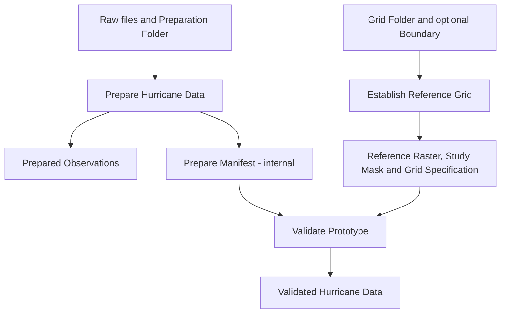
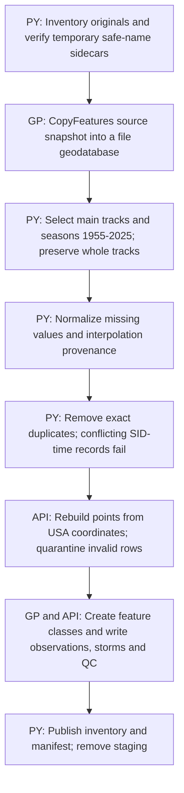
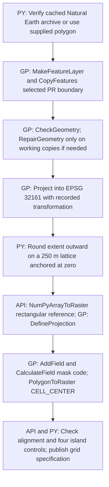
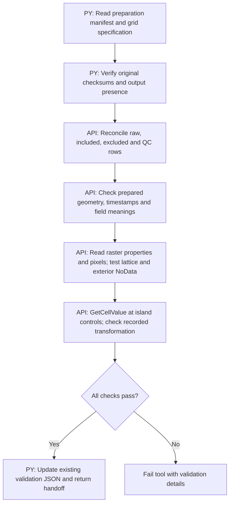
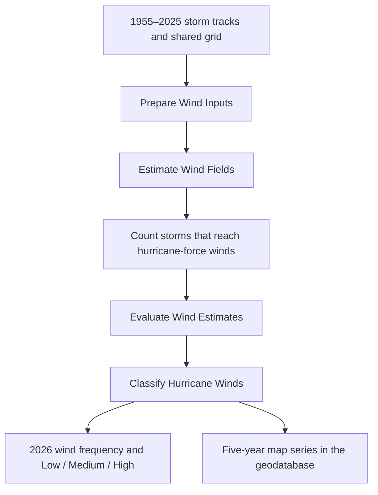
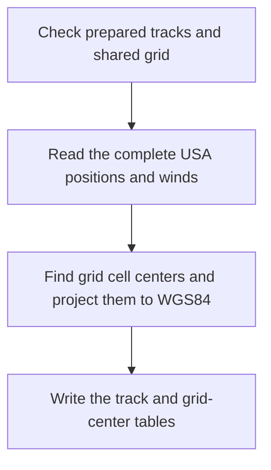
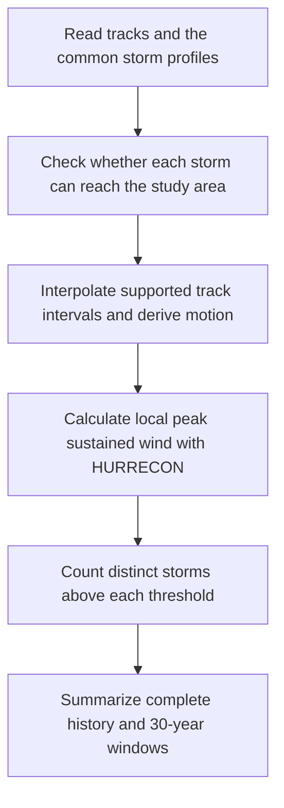
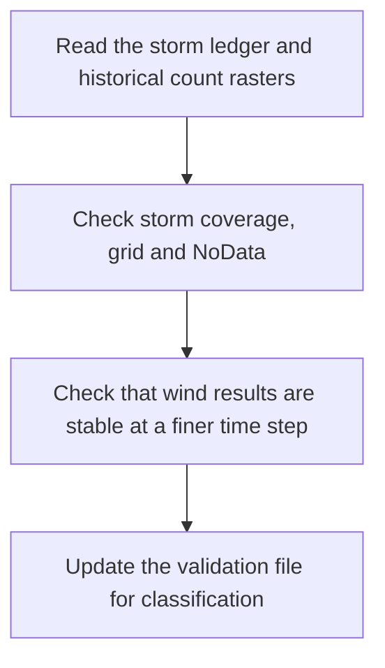

# Hurricane Winds ModelBuilder setup

## Process the historical storm catalog

Open **HurricaneWinds_Estimate_Winds** in **HurricaneWinds_Model_Toolbox.atbx**. Fill in the paths below and click **Run**. The tool processes every prepared storm from 1955 through 2025.

| Box in ArcGIS Pro | Value |
| --- | --- |
| Validated Hurricane Data | `output/hurricane/reports/validation_report.json` |
| Grid Specification | `output/shared/grid/grid_spec.json` |
| Wind Output Folder | `output/hurricane/data` |

Leave **Size Scenarios** and **Reference Wind Observations** blank for the class run. The three stages pass **Wind Workspace** and **Wind Field Catalog** between tools. For classification, use the updated `validation_report.json` from **Evaluate Wind Estimates**, regardless of the label on the saved model form.

## Make the score and class rasters

Run **Classify Hurricane Winds** with the updated **Validated Wind History**, the same **Grid Specification**, and `output/hurricane/data` as **Output Folder**. Spatial Analyst provides **Reclassify**. The tool writes `RiskHurricaneWinds_score250.tif` and `RiskHurricaneWinds_rank250.tif`. The file geodatabase holds the five-year variants and their fitted count breaks in the window table. Three early windows with only zero and one storm retain count and rate maps.

To build the corresponding canvas, right-click the hurricane toolbox in **Catalog**, choose **New → Model**, and drag in **Classify Hurricane Winds**. Double-click the box and enter the three values above. Right-click each of its three input ovals and the two output ovals and click **Parameter**. A **P** on the oval means the item appears on the form when someone opens the saved model. Use **ModelBuilder → Properties** to set Name to `ClassifyWind` and Label to `HurricaneWinds_Classify`. In **Parameters**, put the three inputs first, then **Hazard Score** and **Hazard Class**. Save from the **ModelBuilder** ribbon.

For the same calculation from ArcGIS Pro Python, run `hurricane_winds.py wind-history` followed by `hurricane_winds.py classify` from the repository root. Consult the [classification report](hurricane_classification_report.md) for the score, boundaries and interpretation.

## Combine the two course class rasters

In ModelBuilder, add **Raster Calculator** from **Spatial Analyst Tools → Map Algebra**. Drag in the two completed rank TIFFs listed below. Double-click Raster Calculator and insert both variables by name from the list above the expression box.

| Box in ArcGIS Pro | Value |
| --- | --- |
| Wind class input | `output/hurricane/data/RiskHurricaneWinds_rank250.tif` |
| Drought class input | `output/drought/data/RiskDrought_rank250.tif` |
| Expression | `"RiskHurricaneWinds_rank250" + "RiskDrought_rank250"` |
| Output raster | `output/shared/grid/Combined_sum250.tif` |

If your canvas adds a filename extension to the variable name, insert the variable from the list so the expression matches the canvas. Set **Snap Raster** and **Extent** to `output/shared/grid/reference250.tif`, **Cell Size** to 250 m, and the output coordinate system to EPSG:32161. Right-click both input ovals and the combined raster oval and click **Parameter**. The sum keeps **2, 4, 6, 8 and 10** where those combinations occur. Areas with unknown data in either hazard remain NoData. Use `hurricane_winds.py combine` from ArcGIS Pro Python to reproduce and check the arithmetic.

Use **Unique Values** for the combined map. The saved layout uses a palette with five distinct hues and decreasing brightness as the score increases.

| Total | Color |
| ---: | --- |
| 2 | Yellow `#F5DA6D` |
| 4 | Green `#7CC376` |
| 6 | Blue `#2F99B4` |
| 8 | Violet `#6352A7` |
| 10 | Dark burgundy `#681C38` |

## Compare three-class maps in ArcGIS Pro

Add the continuous **score** TIFF to a map. Right-click that layer in **Contents** and choose **Symbology**. Choose **Classify**, set **Classes** to **3**, and try **Quantile**, **Natural Breaks (Jenks)** and **Equal Interval**. Use **Manual Interval** with the same rate legend when comparing how many storms per year different windows recorded. The production rank rasters show relative standing and use the Natural Breaks fitted to each window. Identical event counts stay together, so the quantile method may yield fewer than three distinct groups. The **class** TIFF contains the approved integer values. Display it with **Unique Values** for the course map. [Esri raster symbology](https://doc.esri.com/en/arcgis-pro/latest/help/data/imagery/symbology-pane.html)

## Existing preparation model

Open `HurricaneWinds_Model_Toolbox.atbx`; its alias is `prrisks`. The saved model's internal name remains `Model`, with label **HurricaneWinds_Fetch_IBTrACS**. The three Script Tools use the root `hurricane_winds.py` functions and `utils/hurricane` plus the shared grid implementation.

## Stage parameters

Use existing writable folders. Relative paths below are relative to the repository root; in floating dialogs use the full paths shown. Keep inputs as File parameters for shapefiles with sidecars.

| Prepare Hurricane Data parameter | Value |
|---|---|
| Raw Points | Local IBTrACS points `.shp` under `Hazard_Variables/Hurricanes` |
| Preparation Folder | `C:/Users/ALEJANDROSVEGANOGALE/Documents/Repos/PLAN6059-PR-Risks-SDSS/output/hurricane/data` |
| Start Season / End Season | 1955 / 2025 |
| Raw Lines / SPC Reports | Optional source `.shp` files, blank allowed |
| Export CSV | False |

| Establish Reference Grid parameter | Value |
|---|---|
| Grid Folder | `C:/Users/ALEJANDROSVEGANOGALE/Documents/Repos/PLAN6059-PR-Risks-SDSS/output/shared/grid` |
| Boundary | Blank for pinned provisional Natural Earth; optional replacement polygon |

| Validate Prototype parameter | Value |
|---|---|
| Prepare Manifest | Connect Prepare Hurricane Data → Prepare Manifest |
| Grid Specification | Connect Establish Reference Grid → Grid Specification |
| Validation Folder | `C:/Users/ALEJANDROSVEGANOGALE/Documents/Repos/PLAN6059-PR-Risks-SDSS/output/hurricane/reports` |

## Lean saved model

The saved preparation canvas has three process boxes. If rebuilding it, add Prepare Hurricane Data, Establish Reference Grid and Validate Prototype inside the existing model item. Keep its internal name and toolbox alias. Connect the two JSON outputs to validation as above. Use **Make Variable → From Parameter** for optional inputs that must be public but are not shown automatically.

For the preparation model, use the same right-click **Parameter** action on the following ovals. In **Properties ? Parameters**, order the input rows as **Raw Points; Preparation Folder; Raw Lines; SPC Reports; Grid Folder; Validation Folder; Boundary**. Raw Lines, SPC Reports and Boundary are optional. Order the output rows afterward as **Prepared Observations; Reference Raster; Study Mask; Grid Specification; Validated Hurricane Data**.

Rename ovals to these labels before arranging the form. Outputs are filled automatically; do not type alternative destinations. Leave **Prepare Manifest** and **Projected Boundary** unchecked: they remain internal data. Grid Specification is both a public output and a connector to validation. Start/End Season and Export CSV remain settings inside Prepare Hurricane Data, defaulting to 1955/2025 and False.

The Script Tool outputs are declared **Derived**. ArcGIS Pro exempts derived outputs from intermediate-data deletion and does not offer the Intermediate toggle for them. Retain that type, leave Parameter unchecked on internal-only connectors, and confirm the preparation manifest and projected boundary survive execution from the Geoprocessing pane. Use Validate to check the graph, Auto Layout only if useful, and Save on the ModelBuilder ribbon; Model Properties → Parameters controls public order. The final validation JSON points to the preparation manifest and grid specification and is the later-processing handoff.

The GDB stores raw points, prepared observations, storms and record QC. The inventory/manifest expose their paths without extra canvas outputs. No duplicate CSV or Markdown audit is written by default. Individual Prepare tools/CLI can request CSV explicitly. Temporary safe-name staging is removed automatically.

## Execution and maintenance

Run the saved model from the Geoprocessing pane after choosing input paths. Source files remain unchanged; inherited extent/mask must not clip selected tracks. Expected snapshot: 128,098 source points, 62,485 prepared points, 1,143 storms. The grid uses EPSG:32161, 250 m, anchor (0,0), 1,140 columns × 267 rows for the provisional default boundary. Grid checks include all four islands and exterior NoData.

`python hurricane_winds.py run --raw-points "path/to/points.shp"` uses the same three stages (ArcGIS Python required). Defaults are `output/hurricane/{data,reports}` and `output/shared/grid`. See [processing design](hurricane_processing_plan.md).

Rebuild Script Tools with `python tools/build_toolbox.py --overwrite --verify` using ArcGIS Python while Pro is closed. This preserves saved model archives but **does not update their graphs** after an interface change; use ModelBuilder for ordinary graph editing. Render the final saved graph with `python tools/export_model_diagram.py`. The maintained figure is [here](../figures/hurricane_modelbuilder_graph.png).

### Troubleshooting the wind model

- A missing catalog means Estimate has not successfully published its output at the expected path. Run the whole chain and inspect its messages; do not create an empty table to bypass validation.
- Choose the **output oval from the preceding tool** in a dropdown when connecting stages. Browsing to a previously saved dataset does not create that dependency.
- If an input seems absent, move overlapping ovals apart. Follow arrows to distinguish the folder going into Prepare from the workspace coming out.
- If a renamed oval still shows its old label, save the model, close its tab and reopen it before making further changes.
- Keep Script Tool outputs **Derived**. Do not change their types to make their files editable. Confirm internal datasets survive a saved-model run.

## Workflow diagrams and tool algorithms

The overviews simplify folders and supporting tables. They describe the saved connections, not the exact positions of boxes in Pro. Open a tool below for its grouped algorithm. **GP** means an actual ArcGIS geoprocessing tool; **API** means ArcPy data access, geometry or array operations; **PY** means Python/NumPy logic. A GUI comparison is explanatory, not a claim that a built-in tool runs the custom algorithm. Runtime data checks can fail a tool; they are not additional public Boolean outputs.

### Hurricane preparation overview

Inside Prepare Hurricane Data

| Implementation | What happens |
|---|---|
| Actual ArcGIS tools | CopyFeatures, CreateFileGDB, CreateFeatureclass, CreateTable, AddFields, Delete (workflow-owned outputs). |
| GUI comparison | Selection resembles Select By Attributes, but filtering/deduplication use Python; geometry and rows are written with InsertCursor. No wind interpolation occurs here. |

Inside Establish Reference Grid

| Implementation | What happens |
|---|---|
| Actual ArcGIS tools | CreateFileGDB, MakeFeatureLayer, CopyFeatures, CheckGeometry, conditional RepairGeometry, Project, AddField, CalculateField, PolygonToRaster, DefineProjection, GetCellValue and GetCount. |
| GUI comparison | Project and Polygon To Raster are direct GUI counterparts. Rectangle extent arithmetic and the grid specification are custom logic. |

Inside Validate Prototype

| Implementation | What happens |
|---|---|
| Actual ArcGIS tools | GetCount and GetCellValue; Describe, Raster, ListFields, ListTransformations and SearchCursor are APIs, not analysis tools. |
| GUI comparison | Properties and table inspection show similar facts manually; the reproducible cross-checks and checksum accounting are custom. |

### Hurricane wind-processing overview

Inside Prepare Wind Inputs

ArcPy uses **Project**, **Create File Geodatabase**, **Create Table** and **Add Fields**. Array and cursor operations read the grid and write the tables.

Inside Estimate Wind Fields

NumPy calculates storm motion, wind bounds and HURRECON winds, then counts each storm once per cell and window. ArcPy writes the resulting count rasters with **NumPyArrayToRaster** and **Define Projection**.

Inside Evaluate Wind Estimates

ArcPy reads the ledger and rasters. Python checks the full record and reports unresolved observations before classification.

