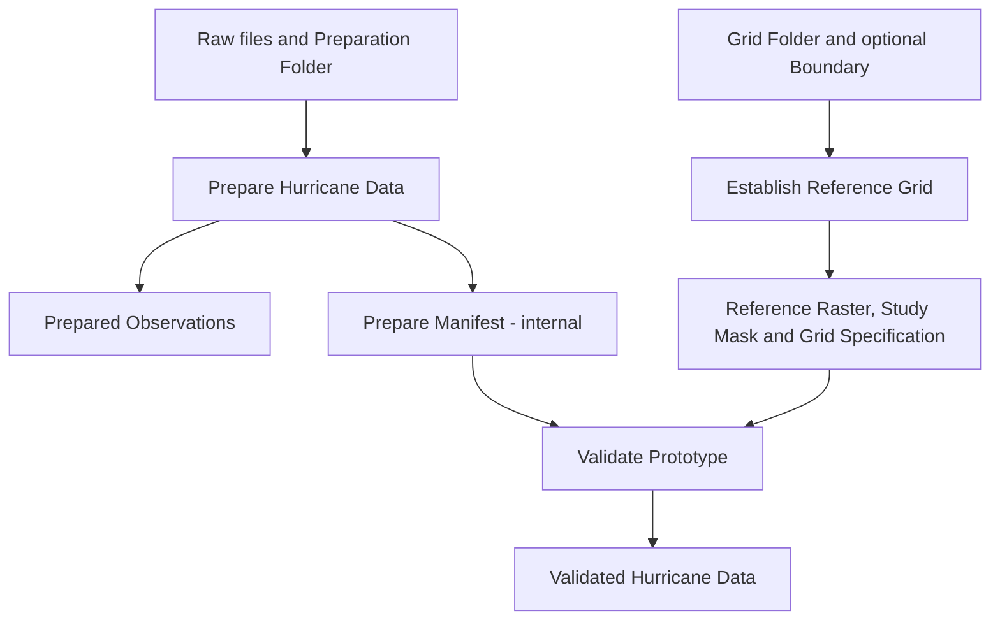
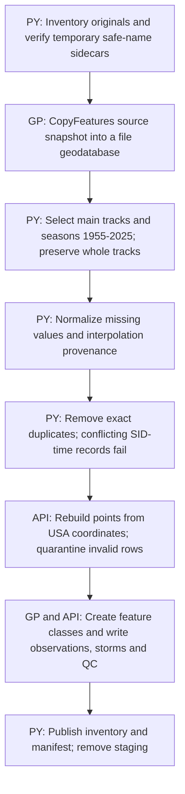
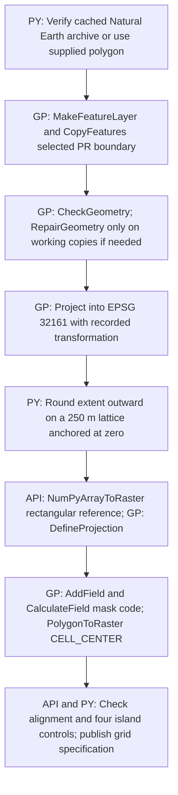
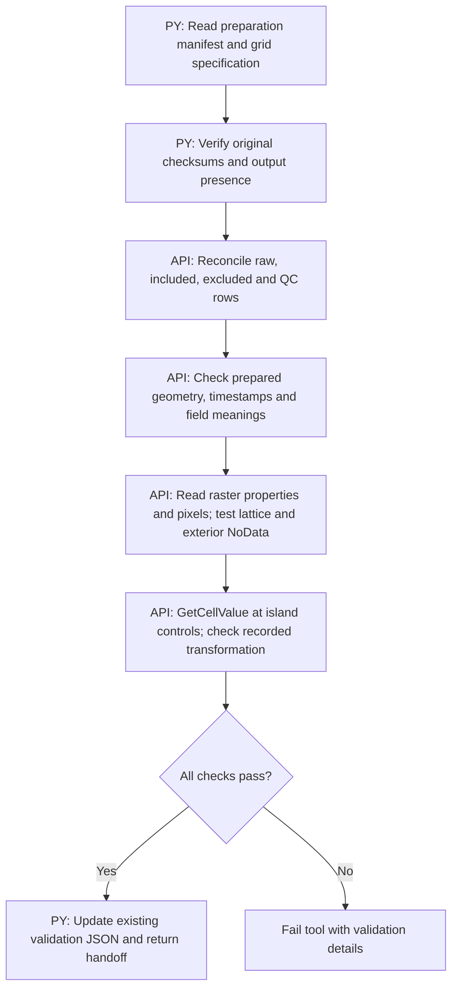
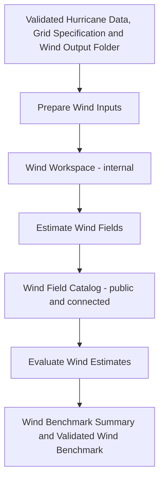
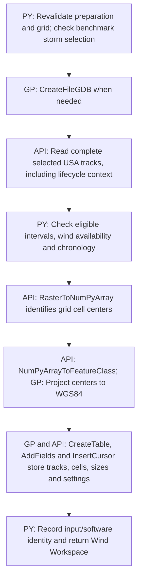
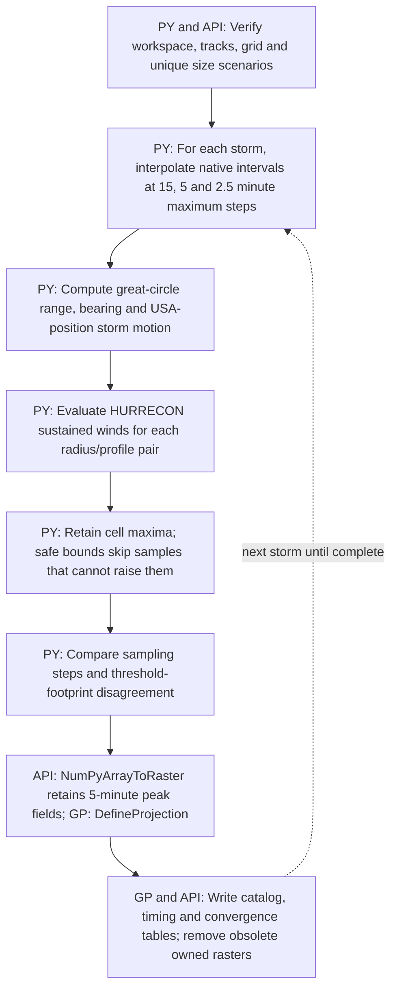
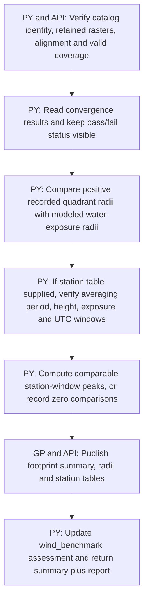

# Hurricane Winds ModelBuilder setup

## Wind-field benchmark model

Open `HurricaneWinds_Model_Toolbox.atbx` in the Catalog pane. It contains two saved models: **HurricaneWinds_Fetch_IBTrACS** (internal name `Model`) and **HurricaneWinds_Estimate_Winds** (`EstimateWinds`). Keep both items and the toolbox alias `prrisks`.

To run the wind benchmark, double-click **HurricaneWinds_Estimate_Winds**, fill in its three inputs using the paths below, then click Run once. Its three outputs are filled automatically. It processes Betsy, Hugo, Georges and Maria; historical aggregation and classification follow a separate review.

To inspect or change the canvas, right-click the model in Catalog and choose **Edit**. The instructions below explain the saved setup; you do not need to recreate it.

If rebuilding the canvas, add **Prepare Wind Inputs**, **Estimate Wind Fields** and **Evaluate Wind Estimates**. Double-click each yellow box to configure its own tool dialog, then click OK. Optional settings remain inside these boxes by default; they are not extra fields on the saved model form.

| Prepare Wind Inputs parameter | Exact value |
|---|---|
| Validated Hurricane Data | `C:\Users\ALEJANDROSVEGANOGALE\Documents\Repos\PLAN6059-PR-Risks-SDSS\output\hurricane\reports\validation_report.json` |
| Grid Specification | `C:\Users\ALEJANDROSVEGANOGALE\Documents\Repos\PLAN6059-PR-Risks-SDSS\output\shared\grid\grid_spec.json` |
| Wind Output Folder | `C:\Users\ALEJANDROSVEGANOGALE\Documents\Repos\PLAN6059-PR-Risks-SDSS\output\hurricane\data` |
| Benchmark Storms | `1956222N13313;1989254N13340;1998259N10335;2017260N12310` |

| Estimate Wind Fields parameter | Value |
|---|---|
| Wind Workspace | Connect the **Wind Workspace model variable** produced by Prepare Wind Inputs |
| Size Scenarios | Blank for the four published pairs, or an input table containing numeric `RMW_KM` and `PROFILE_B` columns |

| Evaluate Wind Estimates parameter | Value |
|---|---|
| Wind Field Catalog | Connect the **Wind Field Catalog model variable** produced by Estimate Wind Fields |
| Reference Wind Observations | Blank unless a qualifying station-observation table is supplied |

Use output-to-input connections for both arrows. Selecting a table/geodatabase directly from disk in place of those model variables would omit the process dependency. Keep all outputs Derived. The workflow writes internal tables and rasters inside the returned workspace; the catalog gives the storm/scenario associations.

### Make the saved model's input/output form (no run needed)

A **model parameter** is an oval marked with **P** on the canvas. It becomes a field when someone double-clicks the whole saved model. This is separate from the settings inside a yellow Script Tool box. Marking parameters does not calculate data.

1. Find the three ovals that feed **into Prepare Wind Inputs**. Rename them **Validated Hurricane Data**, **Grid Specification** and **Wind Output Folder**. The folder path ends in `data`.
2. Right-click each of those three ovals and click **Parameter** so a P appears. Do not mark the yellow boxes.
3. Find **Wind Workspace**, which comes **out of Prepare** and goes **into Estimate**. Its path ends in `hurricane_winds.gdb`. Leave Parameter unchecked on this internal connector.
4. Right-click **Wind Field Catalog**, **Wind Benchmark Summary** and **Validated Wind Benchmark** and check Parameter on each. The catalog is both a public output and the connector feeding Evaluate; preserve its arrow.
5. Open **ModelBuilder ? Properties ? Parameters**. Put the three inputs first, then the three outputs, in the order below. Check types and directions as well as names.
6. Click OK, then click **Save on the ModelBuilder ribbon**. Saving only the project is not sufficient. Running is unnecessary while configuring this form.

| Order | Model field | Direction / type |
|---|---|---|
| 1 | Validated Hurricane Data | Input / File |
| 2 | Grid Specification | Input / File |
| 3 | Wind Output Folder | Input / Folder |
| 4 | Wind Field Catalog | Output / Table |
| 5 | Wind Benchmark Summary | Output / Table |
| 6 | Validated Wind Benchmark | Output / File |

Keep **Benchmark Storms**, **Size Scenarios** and **Reference Wind Observations** inside their individual tool dialogs unless deliberately changing the public interface. To reveal an optional setting on the canvas for inspection, right-click its yellow box ? **Make Variable ? From Parameter** ? choose the setting. This creates an oval; checking **Parameter** on that oval is a separate action. The current saved form has six rows, not nine.

The default scenario table has rows `(20,1.5)`, `(40,1.4)`, `(60,1.3)` and `(80,1.2)`. It is created inside the wind geodatabase. For a custom input, use a separate table so preparation does not replace the supplied scenario values.

The optional station input requires `SID`, `STATION`, `LAT`, `LON`, `WIND_MPS`, `AVG_SECONDS`, `HEIGHT_M`, `COVER`, `START_UTC`, `END_UTC`, `SOURCE`, `LOWER_BOUND`. Use 60-second sustained winds, height 10 m within 0.5 m, COVER `LAND` or `WATER`, complete UTC observation windows, an explicit source, and LOWER_BOUND=0. Invalid/mismatched rows fail with a corrective message. Gusts and incomplete instrument records require a separate evaluation method.

Results use `output/hurricane/data/hurricane_winds.gdb`: 16 default five-minute peak rasters, event catalog, size table, native tracks, geographic cell centers, convergence, timing, reference comparisons and footprint summary tables. Fifteen- and 2.5-minute calculations are compared in memory. The existing `output/hurricane/reports/validation_report.json` receives a `wind_benchmark` section. Read its status, convergence and reference-availability fields when using benchmark results.

Run the three stages from ArcGIS Pro Python through the same root entrypoint:

```powershell
& 'C:/Program Files/ArcGIS/Pro/bin/Python/envs/arcgispro-py3/python.exe' hurricane_winds.py wind-benchmark
```

For individual stages use `wind-prepare`, `wind-estimate` and `wind-evaluate`. Run `--help` for optional parameters. A successful computational benchmark provides size/convergence evidence for review. Select the historical configuration together before extending to 1955-2025 indicators and 1/3/5 ranking.

After saving the graph, run it from the Geoprocessing pane and check that the catalog, rasters, tables and report survive completion. Test a relocated distribution with local source/output paths. Close ModelBuilder tabs and save the project on its map before updating toolbox files.

After both hurricane models are saved, refresh the existing hurricane PNG with both native graphs:

```powershell
& 'C:/Program Files/ArcGIS/Pro/bin/Python/envs/arcgispro-py3/python.exe' tools/export_model_diagram.py --all-models --subtitle 'Preparation and wind benchmark' --footer 'Historical aggregation and hazard ranking await benchmark review'
```

This reads saved diagrams and stacks them into the one hurricane PNG. It does not create or connect ModelBuilder graphs.

## Existing preparation model

Open `HurricaneWinds_Model_Toolbox.atbx`; its alias is `prrisks`. The saved model's internal name remains `Model`, with label **HurricaneWinds_Fetch_IBTrACS**. The three Script Tools use the root `hurricane_winds.py` functions and `utils/hurricane` plus the shared grid implementation.

## Stage parameters

Use existing writable folders. Relative paths below are relative to the repository root; in floating dialogs use the full paths shown. Keep inputs as File parameters for shapefiles with sidecars.

| Prepare Hurricane Data parameter | Value |
|---|---|
| Raw Points | Local IBTrACS points `.shp` under `Hazard_Variables/Hurricanes` |
| Preparation Folder | `C:/Users/ALEJANDROSVEGANOGALE/Documents/Repos/PLAN6059-PR-Risks-SDSS/output/hurricane/data` |
| Start Season / End Season | 1955 / 2025 |
| Raw Lines / SPC Reports | Optional source `.shp` files, blank allowed |
| Export CSV | False |

| Establish Reference Grid parameter | Value |
|---|---|
| Grid Folder | `C:/Users/ALEJANDROSVEGANOGALE/Documents/Repos/PLAN6059-PR-Risks-SDSS/output/shared/grid` |
| Boundary | Blank for pinned provisional Natural Earth; optional replacement polygon |

| Validate Prototype parameter | Value |
|---|---|
| Prepare Manifest | Connect Prepare Hurricane Data → Prepare Manifest |
| Grid Specification | Connect Establish Reference Grid → Grid Specification |
| Validation Folder | `C:/Users/ALEJANDROSVEGANOGALE/Documents/Repos/PLAN6059-PR-Risks-SDSS/output/hurricane/reports` |

## Lean saved model

The saved preparation canvas has three process boxes. If rebuilding it, add Prepare Hurricane Data, Establish Reference Grid and Validate Prototype inside the existing model item. Keep its internal name and toolbox alias. Connect the two JSON outputs to validation as above. Use **Make Variable → From Parameter** for optional inputs that must be public but are not shown automatically.

For the preparation model, use the same right-click **Parameter** action on the following ovals. In **Properties ? Parameters**, order the input rows as **Raw Points; Preparation Folder; Raw Lines; SPC Reports; Grid Folder; Validation Folder; Boundary**. Raw Lines, SPC Reports and Boundary are optional. Order the output rows afterward as **Prepared Observations; Reference Raster; Study Mask; Grid Specification; Validated Hurricane Data**.

Rename ovals to these labels before arranging the form. Outputs are filled automatically; do not type alternative destinations. Leave **Prepare Manifest** and **Projected Boundary** unchecked: they remain internal data. Grid Specification is both a public output and a connector to validation. Start/End Season and Export CSV remain settings inside Prepare Hurricane Data, defaulting to 1955/2025 and False.

The Script Tool outputs are declared **Derived**. ArcGIS Pro exempts derived outputs from intermediate-data deletion and does not offer the Intermediate toggle for them. Retain that type, leave Parameter unchecked on internal-only connectors, and confirm the preparation manifest and projected boundary survive execution from the Geoprocessing pane. Use Validate to check the graph, Auto Layout only if useful, and Save on the ModelBuilder ribbon; Model Properties → Parameters controls public order. The final validation JSON points to the preparation manifest and grid specification and is the later-processing handoff.

The GDB stores raw points, prepared observations, storms and record QC. The inventory/manifest expose their paths without extra canvas outputs. No duplicate CSV or Markdown audit is written by default. Individual Prepare tools/CLI can request CSV explicitly. Temporary safe-name staging is removed automatically.

## Execution and maintenance

Run the saved model from the Geoprocessing pane after choosing input paths. Source files remain unchanged; inherited extent/mask must not clip selected tracks. Expected snapshot: 128,098 source points, 62,485 prepared points, 1,143 storms. The grid uses EPSG:32161, 250 m, anchor (0,0), 1,140 columns × 267 rows for the provisional default boundary. Grid checks include all four islands and exterior NoData.

`python hurricane_winds.py run --raw-points "path/to/points.shp"` uses the same three stages (ArcGIS Python required). Defaults are `output/hurricane/{data,reports}` and `output/shared/grid`. See [processing design](hurricane_processing_plan.md).

Rebuild Script Tools with `python tools/build_toolbox.py --overwrite --verify` using ArcGIS Python while Pro is closed. This preserves saved model archives but **does not update their graphs** after an interface change; use ModelBuilder for ordinary graph editing. Render the final saved graph with `python tools/export_model_diagram.py`. The maintained figure is [here](../figures/hurricane_modelbuilder_graph.png).

### Troubleshooting the wind model

- A missing catalog means Estimate has not successfully published its output at the expected path. Run the whole chain and inspect its messages; do not create an empty table to bypass validation.
- Choose the **output oval from the preceding tool** in a dropdown when connecting stages. Browsing to a previously saved dataset does not create that dependency.
- If an input seems absent, move overlapping ovals apart. Follow arrows to distinguish the folder going into Prepare from the workspace coming out.
- If a renamed oval still shows its old label, save the model, close its tab and reopen it before making further changes.
- Keep Script Tool outputs **Derived**. Do not change their types to make their files editable. Confirm internal datasets survive a saved-model run.


## Workflow diagrams and tool algorithms

The overviews simplify folders and supporting tables. They describe the saved connections, not the exact positions of boxes in Pro. Open a tool below for its grouped algorithm. **GP** means an actual ArcGIS geoprocessing tool; **API** means ArcPy data access, geometry or array operations; **PY** means Python/NumPy logic. A GUI comparison is explanatory, not a claim that a built-in tool runs the custom algorithm. Runtime data checks can fail a tool; they are not additional public Boolean outputs.

### Hurricane preparation overview


<details>
<summary>Inside Prepare Hurricane Data</summary>



| Implementation | What happens |
|---|---|
| Actual ArcGIS tools | CopyFeatures, CreateFileGDB, CreateFeatureclass, CreateTable, AddFields, Delete (workflow-owned outputs). |
| GUI comparison | Selection resembles Select By Attributes, but filtering/deduplication use Python; geometry and rows are written with InsertCursor. No wind interpolation occurs here. |

</details>

<details>
<summary>Inside Establish Reference Grid</summary>



| Implementation | What happens |
|---|---|
| Actual ArcGIS tools | CreateFileGDB, MakeFeatureLayer, CopyFeatures, CheckGeometry, conditional RepairGeometry, Project, AddField, CalculateField, PolygonToRaster, DefineProjection, GetCellValue and GetCount. |
| GUI comparison | Project and Polygon To Raster are direct GUI counterparts. Rectangle extent arithmetic and the grid specification are custom logic. |

</details>

<details>
<summary>Inside Validate Prototype</summary>



| Implementation | What happens |
|---|---|
| Actual ArcGIS tools | GetCount and GetCellValue; Describe, Raster, ListFields, ListTransformations and SearchCursor are APIs, not analysis tools. |
| GUI comparison | Properties and table inspection show similar facts manually; the reproducible cross-checks and checksum accounting are custom. |

</details>

### Hurricane wind-processing overview


<details>
<summary>Inside Prepare Wind Inputs</summary>



| Implementation | What happens |
|---|---|
| Actual ArcGIS tools | CreateFileGDB, Project, CreateTable, AddFields and Delete. NumPyArrayToFeatureClass and cursors are APIs. |
| GUI comparison | Selection and Project have GUI analogues. USA-position motion/coverage validation remains custom; no wind field is generated in this stage. |

</details>

<details>
<summary>Inside Estimate Wind Fields</summary>



| Implementation | What happens |
|---|---|
| Actual ArcGIS tools | DefineProjection, CreateTable, AddFields and Delete; raster/array conversion and cursors are APIs. |
| GUI comparison | There is no one-to-one built-in interpolation tool for HURRECON. Raster Calculator could express pieces of the equations; it does not reproduce track interpolation, bounds and streaming maxima. |

</details>

<details>
<summary>Inside Evaluate Wind Estimates</summary>



| Implementation | What happens |
|---|---|
| Actual ArcGIS tools | CreateTable, AddFields and Delete via table helpers. RasterToNumPyArray and SearchCursor read results. |
| GUI comparison | Raster properties and attribute summaries are inspectable in Pro. Numerical convergence, modeled radii and station comparability are custom. Bad data fail; failed convergence or absent station evidence produce warnings, not an automatic claim of scientific validation. |

</details>
