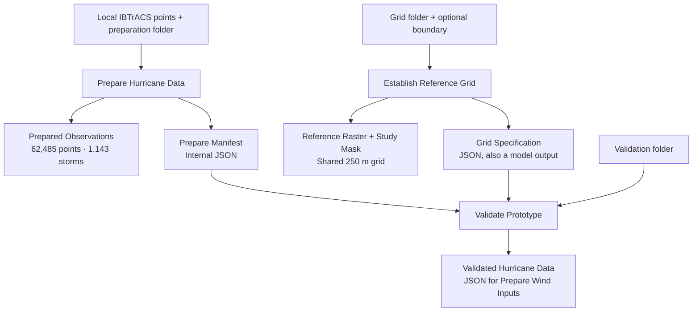
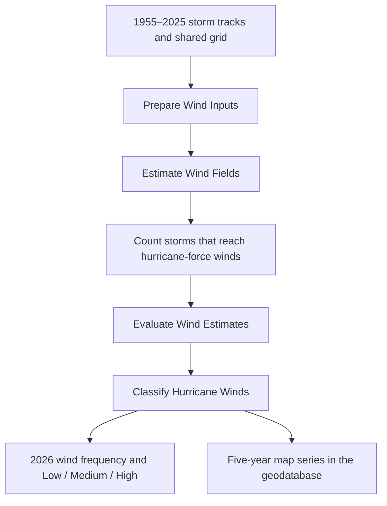

# Hurricane Winds processing plan

The preparation model audits local IBTrACS records and establishes the shared grid. The processing model accounts for the entire 1955–2025 storm catalog and sends its validated history to the classification tool. See the [setup guide](hurricane_modelbuilder_setup.md) and [classification report](hurricane_classification_report.md).

## Discussing the saved hurricane preparation model

**HurricaneWinds_Fetch_IBTrACS** turns the supplied IBTrACS points into auditable storm tracks and builds the shared grid. The two branches meet at **Validate Prototype**. Each arrow into that check represents a file passed by the saved model. See the [setup guide](hurricane_modelbuilder_setup.md#hurricane-preparation-overview) for the full tool diagrams and parameter values.

[Download the hurricane preparation diagram as a PNG](../figures/discussion/hurricane_preparation.png).

| Stage | What to point out in the discussion |
| --- | --- |
| **Prepare Hurricane Data** | Takes a local `.shp` and its sidecars. Optional track lines and SPC reports go into the source inventory. The tool checks the originals, stages safe filenames and uses **Copy Features** to preserve a raw geodatabase copy. Python selects main tracks by stored **1955–2025 season**, normalizes missing values and checks storm ID/timestamp duplicates. ArcPy writes the feature geometry using `USA_LON`/`USA_LAT`, paired with `USA_WIND`. |
| **Establish Reference Grid** | Uses a supplied polygon or the pinned Natural Earth boundary. **Project** puts the boundary in EPSG:32161. **Polygon To Raster** assigns land by cell center, with NoData outside the mask. The reference raster, mask and grid specification give both hazards the same origin, extent and **1,140 × 267** layout. |
| **Validate Prototype** | Reads the preparation manifest and grid specification. It checks original hashes, row accounting, point geometry, grid alignment, island controls and exterior NoData. The public **Validated Hurricane Data** file gives wind preparation a verified route to the point data. The **Grid Specification** is the other data input to wind preparation. |

- **Why keep whole tracks?** Offshore points and weaker stages carry the position and timing context for wind reconstruction. Preparation keeps those portions and applies the Puerto Rico mask to the grid branch. The snapshot reconciles **128,098 source points** to **62,485 prepared observations** across **1,143 distinct storms**.
- **What is measured at a track point?** `USA_WIND` is a storm-wide maximum one-minute sustained wind in knots. It takes the later HURRECON step to estimate local winds at study cells. Preparation carries interpolation flags and preserves the **85 missing wind values** for coverage review.
- **What can you open during the discussion?** Show Prepared Observations in `hurricane_prepare.gdb`, then open `grid_spec.json` to show the projection and cell geometry. The five public outputs are Prepared Observations, Reference Raster, Study Mask, Grid Specification and Validated Hurricane Data (`validation_report.json`). The original-point copy, storm summary, quality-control table and projected boundary are accessible through the workspace and manifests. The 250 m grid defines output alignment. Local wind estimates have coarser information support.

## Wind processing

[Download the wind processing diagram as a PNG](../figures/discussion/hurricane_wind_processing.png).

**Prepare Wind Inputs** reads the full USA tracks and projects the cell centers to WGS84. **Estimate Wind Fields** bounds possible winds from every storm, reconstructs local sustained winds where needed and counts exposures without publishing separate storm rasters. **Evaluate Wind Estimates** checks the event ledger, grid, coverage and time-step sensitivity. The 250 m grid aligns the outputs, while the track data and model assumptions determine their effective information support.

## Wind calculations and geodatabase layers

1. **Prepare locations and tracks.** Read the 1955–2025 USA positions and sustained winds from IBTrACS. Project reference-grid cell centers to longitude and latitude. Keep tropical and subtropical intervals with both endpoints observed and at most six hours apart. Interpolate supported positions and intensities at steps of at most five minutes. Calculate storm motion from the native positions. Use conservative wind bounds for distant or weak samples. Record unresolved exposure as unknown.
2. **Estimate one peak per storm and cell.** For each supported sample, use great-circle distance and bearing from the storm center. HURRECON adjusts the wind for the direction and speed of storm motion and applies a radial wind profile and a land factor. The chosen profile uses a 20 km radius of maximum wind, shape parameter B = 1.5 and land factor 0.8. Keep the highest local 10 m one-minute sustained wind for the storm within the window. The five-minute step sets the evaluation interval.
3. **Count and classify.** Count a storm once at a cell if any modeled peak in the window reaches 64 kt. For example, one qualifying storm in 71 years gives a score of 1/71 storms/year. Fit two Natural Breaks (Jenks) cuts to each window's integer counts across valid cell centers. Equal counts share one class. Apply the 1/3/5 code with **Reclassify** and check all three values and the shared NoData mask. Keep the exact count breaks, source years, raster names and class areas in `wind_reference_windows`.

| Layer or table in `hurricane_winds.gdb` | Definition and units |
| --- | --- |
| `N64_all_YYYY` | Number of distinct storms whose local peak reached ≥64 kt from 1955 through YYYY−1. The 2026 course raster starts with `N64_all_2026`. |
| `N64_rolling_YYYY` | Same count for the 30 complete calendar years YYYY−30 through YYYY−1. For 2026, this is 1996–2025. |
| `H64_score_all_YYYY`, `H64_score_rolling_YYYY` | Corresponding `N64` count divided by years in the window, in storms/year. The default full-history score is `RiskHurricaneWinds_score250.tif`. |
| `H64_rank_all_YYYY`, `H64_rank_rolling_YYYY` | Integer 1/3/5 classes fitted to that window. The default full-history class is `RiskHurricaneWinds_rank250.tif`. Windows with fewer than three distinct counts retain count and rate maps. |
| `H34` | Full-record score for peaks ≥34 kt, in storms/year. |
| `F0_proxy` through `F3_proxy` | Full-record rates in storms/year at ≥18, 26, 36 and 48 m/s, respectively. These thresholds approximate sustained-wind categories in the Boose study. |
| `N64_profile_1` through `N64_profile_4` | Full-record 64 kt counts for radius/B pairs 20/1.5, 40/1.4, 60/1.3 and 80/1.2. Radii are in km. |
| `N64_land_factor_1` | Full-record 64 kt count for the chosen profile with a land factor of 1.0. |
| `H64_affected_years` | Number of calendar years with at least one qualifying storm. Divide by 71 for the fraction of affected years. |
| `H64_last_year`, `H64_years_since` | Last year with a qualifying storm and 2026 minus that year. Cells with zero qualifying storms have no recency value. |
| `wind_event_catalog`, `wind_profile_comparison`, `wind_time_step_comparison` | Per-storm modeling disposition, fit to observed wind radii in km, and cutoff disagreement between the five- and 2.5-minute time steps. |

Use **H64 scores** to compare the magnitude of exposure between windows. A High rank marks the high group within its own window. Sharp diagonal edges can form where a modeled wind swath adds one storm to the cell count. NoData represents locations outside the study mask or an unsupported observation window. Valid zero counts remain zero.

## IBTrACS preparation contract

This contract defines the Hurricane Winds prototype's observations and provenance. The [wind-estimation section below](#hurricane-wind-spatial-estimation-options-and-validation-gate) documents HURRECON and other published approaches.

## Inputs and preservation

The primary source is the local North Atlantic **IBTrACS v04r01 points shapefile** under `Hazard_Variables/Hurricanes`. Optional raw line and SPC wind-report inputs are inventoried for context; neither is substituted for the hurricane observations. SPC severe-wind reports are reports of events, not a hurricane surface or interchangeable hurricane intensity measurements.

The source files remain unchanged. Preparation stages the shapefile and matching sidecars under a safe common basename because the supplied IBTrACS basenames contain multiple dots and may not be accepted as ArcGIS dataset paths. The raw input is consequently exposed as a **File** parameter filtered to `shp`. Required sidecars are checked before use. Staging is temporary and is removed on success or failure. This is a dataset staging operation, not a repair of scientific attributes.

The output geodatabase preserves a raw point copy with the source geometry and attributes. The prepared observation feature class instead rebuilds geometry from valid **USA_LON/USA_LAT in WGS84 (EPSG:4326)**. Never substitute the combined source geometry or LAT/LON when USA coordinates are unusable. This makes the location, USA_WIND, and related agency attributes follow a declared source family. The inventory records input paths, sidecars, sizes/checksums and spatial-reference information; the audit records source geometry/USA-coordinate differences and the field-name mapping.

## Selection and row accounting

The default cohort uses an exact, case-insensitive `main` match after trimming TRACK_TYPE and **1955 <= SEASON <= 2025**, inclusive. Use the stored season, not the observation calendar year or SID prefix, to select the cohort. Retain every selected track observation across its whole lifetime; do not clip points to Puerto Rico or remove offshore/weak stages before interpolation and modeling.

An exact duplicate means identical source attributes and source geometry, with source object ID excluded from the comparison. Remove those duplicates deterministically while recording them. Conflicting rows with the same SID and timestamp are a separate condition: retain their evidence in QC tables and stop preparation rather than silently selecting an intensity or location.

Selected records missing a usable SID, UTC timestamp, or USA coordinate pair are quarantined: preserve them in the raw-point/QC accounting, and exclude them from the prepared spatial observations. Missing wind, pressure, radii, or agency text alone does not remove an otherwise usable observation. Successful spatial preparation does not mean the record is ready for a physical model.

The raw-point feature class and QC table account for every active source row. SOURCE_OID connects the prepared records to the snapshot. Row statuses are INCLUDED, EXCLUDED_TRACK_TYPE, EXCLUDED_SEASON, QUARANTINED, DUPLICATE_EXACT and CONFLICT. Counts must reconcile to the raw-point table; deleted DBF records are reported separately. CSV is an optional export, off by default. Future adapters should consume normalized prepared attributes and preserve QC/coverage.

## Field semantics and project policy

The source authority is NOAA's [v04r01 column guide](https://www.ncei.noaa.gov/sites/default/files/2025-09/IBTrACS_v04r01_column_documentation.pdf). The original CSV names can differ from shapefile field names; the inventory/audit's actual field map is authoritative for a run. Important groups are:

| Fields | Meaning used by this project |
| --- | --- |
| SID, SEASON, ISO_TIME | Storm identity, selected season, and UTC observation time. |
| USA_LAT, USA_LON | Agency-family coordinates for rebuilt WGS84 geometry. |
| USA_WIND | 1-minute sustained maximum wind, knots. |
| USA_PRES, USA_POCI | Central/environmental pressure, mb; preserve missing values. |
| USA_RMW, USA_ROCI | Radius of maximum wind/outer closed isobar, nautical miles. |
| USA_R34/50/64_NE/SE/SW/NW | Quadrant wind-threshold radii, nautical miles. |
| USA_AGENCY, IFLAG | Reporting-source and interpolation provenance. |
| STORM_SPEED/STORM_SPD, STORM_DIR/STORM_DR | IBTrACS merged motion fields; audit provenance separately. |

The [NOAA technical guide](../references/IBTrACS_version4r01_Technical_Details.pdf) discusses averaging/height on printed page 5, uncertainty and reporting differences on pages 7-11, interpolation/spurs on pages 11-12, and combined/USA variables on pages 18-19. The USA family can change supplying agency between timestamps. Preserve those changes; never fill a blank USA_AGENCY from a neighboring row or infer it from the basin.

### Interpolation flags

`USA_IFLAG` is derived from **the first character** of the 15-character IFLAG, not from the entire string. NOAA's flag definitions are: O original; P position and other quantities interpolated/filled; I position supplied but intensity filled; V original position/intensity with some other values filled; underscore means no report. These are provenance labels, not numerical quality scores. See printed page 2 of the column guide.

Retain P records and blank agency text in the selected prepared data and report their counts. This explicitly permits IBTrACS interpolation while making it visible. Do not call the retained dataset an original-only observation sample. A blank/short IFLAG yields an unavailable USA flag and a QC observation, not an invented flag. Subsequent model-specific interpolation/imputation must add its own provenance rather than overwrite the raw IFLAG.

### Missing values and units

Normalize documented numerical missing sentinels to null for analytical use while retaining the source copy. Do not apply one negative-value rule to every field: negative longitude and latitude are legitimate, and USA_SSHS includes valid negative categorical codes. Preserve zero values for review; neither a missing wind nor an absent radius is zero exposure. Report unexpected ranges and unsupported values instead of quietly clamping them.

Keep source units in preparation. Downstream engines must perform explicit conversions: kt to m/s, nautical miles to km or meters, and mb/hPa to Pa where required. Conversion factors and output units belong in their settings or manifests. No averaging-period conversion, gust factor, radius gap-fill, pressure estimate, temporal resampling, or wind-field interpolation occurs in preparation.

`OBS_TIME_UTC` is an ArcGIS date representing UTC; ISO_TIME remains available for unambiguous text exchange. Never interpret it using the workstation's local timezone. Retain existing merged storm-motion fields in preparation. The wind-processing model derives separate motion from the USA positions; it does not overwrite those source fields.

### Storm status is not one interchangeable code system

Retain both NATURE and USA_STATUS. In **NATURE**, TS means tropical and ET means extratropical. In **USA_STATUS**, TS means tropical storm, EX means extratropical, and ET means extrapolated. The preparation preserves complete selected tracks, and the wind processing models NATURE TS/SS observations and intervals. Tropical-depression status bounds the missing winds during those particular observations.

## Outputs and consumer rules

| Product | Use |
| --- | --- |
| `hurricane_prepare.gdb/raw_ibtracs_points` | Preserved raw ArcGIS dataset with source geometry. |
| `hurricane_prepare.gdb/hurricane_observations` | Selected, deduplicated, spatially usable USA-coordinate observations. |
| `hurricane_prepare.gdb/hurricane_storms` | Distinct-storm summary and coverage information. |
| `hurricane_prepare.gdb/hurricane_qc` | Record-level exclusions, provenance and quality evidence. |
| `hurricane_observations.csv` | Optional portable export; off by default. |
| `source_inventory.json` | Source inventory and schema/provenance facts. |
| `prepare_manifest.json` | Machine-readable locations and preparation summary. |

Prepared features retain source attributes with analytical missing values normalized, plus `SOURCE_OID`, `USA_IFLAG`, `OBS_TIME_UTC`, and `QC_FLAGS`. The optional CSV contains all active source rows, including excluded rows, with original DBF text, normalized core columns and row dispositions; its row count differs from the selected feature class. Consumers should read paths from the manifest rather than depend on the current working directory. SOURCE_OID is the zero-based original shapefile record index, a traceability key for this snapshot rather than a global observation identifier.

Keep these meanings distinct downstream: **zero** is an eligible modeled/observed value; **null** is an unavailable attribute; **NoData** is unsupported spatial/temporal coverage. A prepared record's existence does not authorize an engine to turn missing pressure, radius, or wind into a calm field. Any future imputation must be separately justified, flagged, tested, and included in the coverage report.

## Acceptance checks

- Source hashes and source geometry survive preparation unchanged; staged files share a safe basename.
- The selected feature class contains only the requested seasons/main tracks, valid USA-coordinate geometries and unique SID/time observations.
- Quarantined or conflicting records remain traceable, and all row-status counts reconcile to the source.
- P, I, V, missing agency/flag values, status distributions, wind/radius availability and coordinate differences appear in the audit.
- Raw-point/QC tables reconcile with prepared observations; requested CSV exports agree too.
- No surface, probability, 1/3/5 class or hazard ranking is presented as a preparation output.

# Hurricane wind spatial estimation: options and validation gate

The preparation workflow audits IBTrACS observations and establishes the shared grid. The HURRECON implementation assesses the full storm record and uses one common size profile selected against reported wind radii.

## Quantity to estimate

The modeled quantity is each storm's maximum **10 m, 1-minute sustained wind speed** over supported tropical/subtropical intervals at each study-land cell. The catalog preserves event identity; the shared study mask supplies spatial coverage and exterior NoData. The storm ledger records both supported and unresolved intervals. A hurricane's reported maximum wind is the strongest wind within its circulation; it is not the wind at every location near its track. NOAA discusses measurement height, exposure, averaging periods, and the approximately 0.1-degree source resolution on printed page 5 of the [IBTrACS technical guide](https://www.ncei.noaa.gov/sites/default/files/2025-04/IBTrACS_version4r01_Technical_Details.pdf). The grid's 250 m cell size is an integration convention, not evidence of 250 m meteorological accuracy.

Use **64 kt** as the primary future hurricane-force threshold and **34 kt** as a separately labeled tropical-storm-force sensitivity scenario. The proposed historical statistic is the number of distinct storms reaching or exceeding the threshold in each cell, divided by the **71 seasons from 1955 through 2025**. Its unit is events per year. It is not the probability of at least one exceedance in a year: multiple storms can occur in a year. That probability requires distinct affected-year counts and a declared treatment of incompletely observed years. No such statistic or **1/3/5 reclassification** is implemented here.

## Candidate methods

| Candidate | Appropriate role | Main limitation to resolve |
| --- | --- | --- |
| HURRECON equations | Full-record local wind reconstruction | Compare radius profiles and land reduction against the chosen configuration. |
| CLIMADA | Independent implementation and model-choice comparison | Separate environment; make provider, imputation, distance, cutoff, and wind-model settings explicit. |
| Recorded IBTrACS quadrant radii | Compare modeled 34/50/64 kt footprints where observations exist | Coverage varies through history; missing radii cannot mean zero exposure. |
| Tropycal track proximity | Exploratory storm selection and alternative track-statistics checks | Proximity is not a wind-field reconstruction. |
| `tcwind` | Small experimental Holland-model reference | Scientific normalization, missing-data behavior, and illustrative imputations require review. |

### HURRECON: full-record reconstruction

The reference HURRECON package accepts track location and maximum wind, plus radius/profile parameters and a land-water representation. Its regional workflow produces peak-wind GeoTIFF products and distinguishes land/water friction; it does not require central pressure. Parameter defaults still express scientific assumptions. See the author's [Python workflow and input definitions](https://github.com/hurrecon-model/HurreconPython).

Our implementation uses the published equations with NumPy rather than invoking that package. It transforms the existing projected cell centers to WGS84, evaluates winds there, and writes the results directly onto the original EPSG:32161 lattice. No geographic wind raster is generated or resampled. An external-engine comparison must preserve those same evaluation locations.

The [Harvard Forest HF446 archive](https://harvardforest1.fas.harvard.edu/exist/apps/datasets/showData.html?id=HF446) provides version 1.1 source released in 2024 and a traceable research history. This supplies a documented comparison basis, but it does not establish that the published parameter choices fit Puerto Rico. Treat alternative radius/profile values as labeled project sensitivity scenarios, not universally valid defaults. Preserve the distinction between sustained wind, gust speed, and modeled damage: these are separate outputs, and only the first matches the proposed target.

### CLIMADA: comparison with explicit controls

CLIMADA's `TropCyclone.from_tracks` models event-maximum 1-minute 10 m wind at centroids in m/s. The documented default is **H08**, with H1980, H10, and ER11 alternatives. Defaults include a **17.5 m/s storage threshold**, **300 km eye-distance cutoff**, and equirectangular distance metric; these must appear in benchmark manifests rather than remain hidden. H10 also exposes a pressure-derived maximum-wind option. See the [CLIMADA tropical-cyclone API](https://climada-python.readthedocs.io/en/stable/api/climada/climada.hazard.trop_cyclone.html).

Do not infer complete input coverage from a successful run. The [windfield source](https://climada-python.readthedocs.io/en/stable/_modules/climada/hazard/trop_cyclone/trop_cyclone_windfields.html) estimates missing RMW during conversion and contains NaN-to-zero handling. An adapter must carry an external validity mask and imputation flags. The [track importer source](https://climada-python.readthedocs.io/en/stable/_modules/climada/hazard/tc_tracks.html) also has provider selection and interpolation policies: choose USA explicitly or construct validated track objects from our canonical data; do not silently replace them with the importer's provider hierarchy.

CLIMADA 6.2.0 is available. The newer development installation documentation lists Python 3.11 as supported and 3.11-3.13 as allowed, while some stable documentation pages still display the older matrix. Pin the release and its environment specification when evaluating compatibility. A separate comparison environment remains the deployment choice for CLIMADA. Its installation guidance includes Mamba, Conda and Pixi options. The current benchmark uses ArcGIS Pro's bundled NumPy and ArcPy. [Releases](https://github.com/CLIMADA-project/climada_python/releases), [installation](https://climada-python.readthedocs.io/en/latest/getting-started/install.html).

### Recorded radii and Tropycal

Where available, the four USA quadrant radii describe the recorded maximum reach of the **34, 50, and 64 kt** wind thresholds in nautical miles. They are a useful footprint comparison and coverage audit, not complete continuous wind fields. No observed radius is invented where absent; avoid interpolating across unsupported time spans or treating blank/zero radii as universal evidence of no wind. Definitions are on printed page 4 of the [IBTrACS column guide](https://www.ncei.noaa.gov/sites/default/files/2025-09/IBTrACS_v04r01_column_documentation.pdf).

Tropycal can find analog tracks near points/shapes and calculate track statistics. Its [TrackDataset API](https://tropycal.github.io/tropycal/api/generated/tropycal.tracks.TrackDataset.html) defaults to online HURDAT2, excludes recent best-track additions unless requested, and has separate IBTrACS provider modes. Pin the data snapshot and provider rather than accepting defaults. Its [data-source discussion](https://tropycal.github.io/tropycal/data.html) explains agency differences. Hourly interpolated point proximity can miss a fast crossing between samples; continuous segment-distance checks are more suitable for selection. Neither approach establishes local hurricane-force wind. Tropycal is not a prototype dependency, and its compatibility with the local Pro environment has not been tested.

### `tcwind`: findings from static source inspection

The inspected revision is [`d3a379ce880297ee36e53be3fd741981501a30e2`](https://github.com/zhang-962464/tcwind/tree/d3a379ce880297ee36e53be3fd741981501a30e2), the initial June 8, 2026 commit. The repository had no tags or releases at inspection. Its [manifest](https://github.com/zhang-962464/tcwind/blob/d3a379ce880297ee36e53be3fd741981501a30e2/pyproject.toml) declares version 0.1.0, Python >=3.9, NumPy >=1.20, and optional netCDF4. This is a dependency description, not a successful ArcGIS compatibility test.

The [ingestion module](https://github.com/zhang-962464/tcwind/blob/d3a379ce880297ee36e53be3fd741981501a30e2/tcwind/data/ibtracs.py) reads CSV using combined `LAT/LON` with USA wind, pressure, and RMW. It does not enforce our USA-coordinate/provenance policy or read the local shapefiles directly. Its interpolation can extend observed RMW to endpoints; its RMW gap-filler explicitly uses illustrative western North Pacific coefficients. Those choices need flags and basin-specific review.

Static deductions from the [physics implementation](https://github.com/zhang-962464/tcwind/blob/d3a379ce880297ee36e53be3fd741981501a30e2/tcwind/physics/holland.py), **not executed or observed failures**:

- Missing pressure or RMW can become zero radial wind through `nan_to_num`; with finite positions and Vmax, an unresolved input can therefore appear calm.
- B derives from input Vmax, and the final field receives a 0.9 surface factor. In the stationary, equatorial, unclipped-B case, 50 m/s input yields a 45 m/s modeled peak. The treatment of an already surface-based USA_WIND needs normalization review.
- The translation correction has zero weight for exactly opposing flow, so its stated opposite-side reduction is not guaranteed by the implementation.
- The optional intensity/latitude B formula is explicitly illustrative, and the engine does not apply land friction or terrain effects.

The [core API](https://github.com/zhang-962464/tcwind/blob/d3a379ce880297ee36e53be3fd741981501a30e2/tcwind/core.py) could evaluate existing cell-center coordinates through `at_points`, avoiding a second grid and large time cubes. Its default environmental pressure is 1013 mb. The four [test modules](https://github.com/zhang-962464/tcwind/tree/d3a379ce880297ee36e53be3fd741981501a30e2/tests) contain useful synthetic checks; they do not establish Puerto Rico observational skill. No tcwind code was executed during this review.

### Corrections to the supplied comparison report

The report's performance claim requires a paired model experiment. Our local implementation choice follows deployment needs and the Puerto Rico research precedent. Historical size remains uncertain even when central pressure is unnecessary.

- Boose's Table 1 lists sustained winds of 18-25, 26-35, 36-47 and 48-62 m/s for F0-F3. The suggested Saffir-Simpson crosswalk and recurrence classification cannot be attributed to those table boundaries. The 64 kt hurricane-force threshold converts to 32.924444... m/s and 34 kt to 17.491111... m/s. Use `1852/3600` for knots-to-m/s conversion.
- The four tested size pairs are 20 km/B=1.5, 40/1.4, 60/1.3 and 80/1.2. The report's 30/1.4 combination is a project assumption. Recalculating its stationary 135 kt, 30 km/B=1.4 example gives outer 64 kt radii of 166.85 km over water and 116.25 km over land. Its claimed CLIMADA comparison and plotted radii need correction.
- Actual snapshot checks found 62,400/62,485 usable winds (99.86%), positive pre-1979 central pressure in 6,908/19,907 records (34.70%), and positive pre-2004 RMW in 1,939/39,435 records (4.92%). There are 85 missing winds, all in USA_STATUS=TD/NATURE=TS records, and zero positive pre-2004 R64 quadrant radii. Preserve these limitations when extending the historical cohort.
- Van Beusekom's study fits storm parameters, applies terrain sheltering, and computes gale-wind energy. Those features require additional work beyond the friction-only benchmark.
- Correct the report's bibliographic attribution to Cannon et al. (2023), rather than Ibanez, for the North American hurricane-regime paper. Correct Van Beusekom's author list and treat STORM generation and wind-probability papers as separate publications. The population-exposure paper is by Jing et al., rather than Chen.

### Evidence matrix

| Article | Data and spatial support | Indicator/model and thresholds | Evaluation and transfer to this project |
|---|---|---|---|
| Boose, E.R., Serrano, M.I. & Foster, D.R. (2004), *Landscape and regional impacts of hurricanes in Puerto Rico*, Ecological Monographs 74, 335-352. [DOI](https://doi.org/10.1890/02-4057) | HURDAT and historical damage; 43 reconstructed storms, 1851-1997; regional modeling at 3 km and finer damage/exposure analyses | HURRECON sustained wind, gust and Fujita damage; four size/profile combinations | Seven storms informed parameterization; 36 others supported independent damage comparison. Supplies equations and sensitivity cases. Damage recurrence and local wind-force frequency need separate interpretation. |
| Van Beusekom, A.E., Alvarez-Berrios, N.L., Gould, W.A., Quinones, M. & Gonzalez, G. (2018), *Hurricane Maria in the U.S. Caribbean: Disturbance Forces, Variation of Effects, and Implications for Future Storms*, Remote Sensing 10, 1386. [DOI](https://doi.org/10.3390/rs10091386) | Maria/Irma NWS forecasts; MODIS 250 m EVI; 30 m terrain summarized at target cells | Fitted HURRECON profiles, 10-minute field time steps, terrain sheltering and gale-wind energy above 17 m/s | Vegetation/landslide response models evaluated against observed effects. Supports a process-based 250 m calculation; canopy response also depends on landscape properties. |
| Cannon, J.B., Peterson, C.J., Godfrey, C.M. & Whelan, A.W. (2023), *Hurricane wind regimes for forests of North America*, PNAS 120, e2309076120. [DOI](https://doi.org/10.1073/pnas.2309076120) | Western North Atlantic/eastern North Pacific tracks, 1851-2022; 886 selected hurricanes | HURRECON wind fields, estimated storm size, wind-threshold recurrence and regional regimes | Includes HRRR model comparison and uncertainty in radius prediction. Supports multi-event wind analysis and the need to evaluate size assumptions; an external model comparison has different information support from station measurements. |
| Holland, G.J. (2008), *A revised hurricane pressure-wind model*, Monthly Weather Review 136, 3432-3445. [DOI](https://doi.org/10.1175/2008MWR2395.1) | Hurricane pressure, wind and motion data | Pressure-wind relationship underlying the H08 alternative | Explains physical inputs and historical pressure uncertainty. Useful for evaluating an alternative model; our local field inventory determines actual pressure availability. |
| Aznar-Siguan, G. & Bresch, D.N. (2019), *CLIMADA v1: a global weather and climate risk assessment platform*, GMD 12, 3085-3097. [DOI](https://doi.org/10.5194/gmd-12-3085-2019) | Global hazard/exposure datasets and application examples with varying spatial support | Hazard, exposure, impact and adaptation framework | Supports reproducible alternative hazard modeling. Use current version-specific API documentation for wind-model controls. Loss-function parameters require exposure and vulnerability interpretation. |
