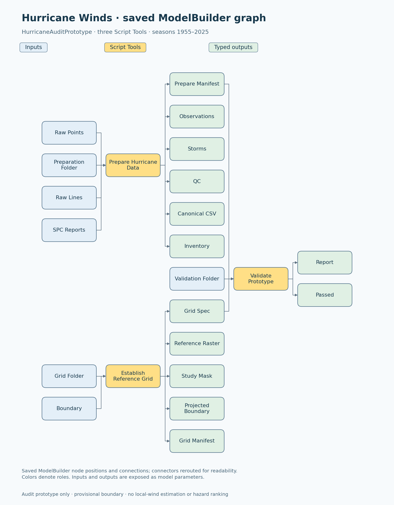

# ArcGIS Pro Script Tools and ModelBuilder setup

The prototype exposes three visible stages: **Prepare Hurricane Data**, **Establish Reference Grid**, and **Validate Prototype**. The Python code performs the work; classmates use familiar geoprocessing dialogs. The supplied toolbox includes the manually assembled, saved and executed **HurricaneAuditPrototype** ModelBuilder model.

This diagram renders the saved ModelBuilder XML's node positions and connections, with connectors rerouted for readability. It is generated by `tools/export_model_diagram.py`; it does not author or modify the model. An [SVG version](hurricane_modelbuilder_graph.svg) and a [simplified design diagram](hurricane_prototype_workflow.svg) are available. See [execution evidence](verification.md).

## Run the supplied model

In Catalog, add `PRRisks.atbx`, then open **HurricaneAuditPrototype**. Select the raw points `.shp`, optional lines/SPC `.shp` files, and separate **existing** preparation, grid and validation folders. Leave Boundary blank for the cached/downloaded Natural Earth country boundary, or select an approved replacement polygon. Run the model; the seasons are fixed at 1955–2025. Changing seasons for exploratory work requires editing the preparation stage or running that Script Tool directly.

The model has internal tool name **`Model`**, alias **`prrisks`**, and display label **`HurricaneAuditPrototype`**. ArcPy calls use `arcpy.prrisks.Model(...)`, not the display label. Its inputs are:

| Index | Label | ArcPy name | Type |
|---|---|---|---|
| 0 | Raw Points | `Raw_Points` | Required File |
| 1 | Preparation Folder | `Preparation_Folder` | Required Folder |
| 2 | Raw Lines | `Raw_Lines` | Optional File |
| 3 | SPC Reports | `SPC_Reports` | Optional File |
| 4 | Grid Folder | `Grid_Folder` | Required Folder |
| 5 | Validation Folder | `Validation_Folder` | Required Folder |
| 7 | Boundary | `Boundary` | Optional polygon Feature Layer |

Its 13 derived output parameters are Report (index 6), Observations (8), Prepare Manifest (9), Storms (10), QC (11), Canonical CSV (12), Inventory (13), Grid Spec (14), Reference Raster (15), Study Mask (16), Projected Boundary (17), Grid Manifest (18), and Passed (19). All stage outputs are model parameters so they remain available after execution and can connect to other models. No output path is entered manually; each stage's output folder determines its published paths. See [Esri's intermediate-data rules](https://doc.esri.com/en/arcgis-pro/latest/help/analysis/geoprocessing/modelbuilder/intermediate-data.html).

The saved default paths are relative to the distribution root. Raw datasets and generated output folders are not included in the code ZIP; choose your own paths when opening the model. Move the whole code folder rather than the toolbox alone.

## Toolbox layout and authoring

The supplied **`PRRisks.atbx`** contains the model and three configured Script Tools. In Catalog, choose **Add Toolbox** and select that root-level file. Keep `scripts/`, `utils/`, and `hurricane_winds.py` beneath the same distribution root. The Script Tool definitions were verified with ArcGIS Pro's `ImportToolbox` and `GetParameterInfo` against the 12/7/5 parameter contracts below.

To recreate the three tools from their source definitions, run `python tools/build_toolbox.py --overwrite --verify` in the Pro environment. The builder preserves other archive members, model references, and resources, including a manually authored model. Close active toolbox editing before regeneration and verify a copy first after changing ArcGIS versions. The small format writer follows the attributed MIT-licensed autobox serialization pattern; see [third-party notices](../THIRD_PARTY_NOTICES.md). This is not an ArcPy ModelBuilder-authoring API.

For manual authoring or recovery, right-click the root folder and choose **New > Toolbox (.atbx)**. Right-click that toolbox, choose **New > Script**, and configure each tool below. On Execution, link the external adapter script; keep the source external while developing.

Esri documents automatic relative script paths when the linked script is beside or below an `.atbx` file. Move/share the entire folder tree. A toolbox alone is insufficient when it links to external scripts/modules. Do not link to a machine-specific absolute script path elsewhere. See [Create a script tool](https://doc.esri.com/en/arcgis-pro/latest/help/analysis/geoprocessing/basics/create-a-python-script-tool.html).

Adapters read geoprocessing parameters, call the same core functions as the CLI, publish outputs, and forward errors/messages. They do not duplicate the scientific or audit logic. Internal tool names below are alphanumeric; labels are human-readable. Keep the listed parameter **order** unchanged because the adapters use numeric indices.

## Exact parameter definitions

In these tables, **Derived Output** means Type = Derived and Direction = Output; the user does not enter its value. Input defaults belong in the toolbox parameter configuration as well as the adapter's fallback. Set File filters to extensions without a leading dot.

### Prepare Hurricane Data

Internal name: `PrepareHurricaneData`  
Execution: `scripts/prepare_hurricane_data.py`

| Index | Label | ArcGIS data type | Type / direction | Default or filter |
| --- | --- | --- | --- | --- |
| 0 | Raw Points | File | Required Input | File: shp |
| 1 | Output Folder | Folder | Required Input | Use a preparation-specific folder. |
| 2 | Start Season | Long | Optional Input | 1955 |
| 3 | End Season | Long | Optional Input | 2025 |
| 4 | Raw Lines | File | Optional Input | File: shp |
| 5 | SPC Reports | File | Optional Input | File: shp |
| 6 | Observations | Feature Class | Derived Output | Rebuilt USA-coordinate observations. |
| 7 | Storms | Table | Derived Output | Distinct-storm summary. |
| 8 | QC | Table | Derived Output | Record-level QC evidence. |
| 9 | Canonical CSV | File | Derived Output | File: csv |
| 10 | Inventory | File | Derived Output | File: json |
| 11 | Prepare Manifest | File | Derived Output | File: json |

The raw inputs intentionally use File rather than Feature Class: their dotted names must be staged safely before ArcGIS dataset recognition. It is still necessary to retain all shapefile sidecars. A `.shp` path alone is not a self-contained dataset. Preparation's subsequent output is a real Feature Class so ordinary tools can consume it.

### Establish Reference Grid

Internal name: `EstablishReferenceGrid`  
Execution: `scripts/establish_reference_grid.py`

| Index | Label | ArcGIS data type | Type / direction | Default or filter |
| --- | --- | --- | --- | --- |
| 0 | Output Folder | Folder | Required Input | Use a grid-specific folder. |
| 1 | Boundary | Feature Layer | Optional Input | Feature Type: Polygon |
| 2 | Reference Raster | Raster Dataset | Derived Output | 250 m alignment template. |
| 3 | Study Mask | Raster Dataset | Derived Output | Puerto Rico/Vieques/Culebra/Mona study mask. |
| 4 | Projected Boundary | Feature Class | Derived Output | EPSG:32161 polygon boundary. |
| 5 | Grid Spec | File | Derived Output | File: json |
| 6 | Grid Manifest | File | Derived Output | File: json |

Leave Boundary blank to acquire **Natural Earth 5.1.1 Admin 0 Countries at 1:10 million**, select `ADM0_A3 = PRI`, and preserve the pinned archive/version/checksum receipt. This generalized cartographic boundary is explicitly provisional: the dataset's `10m` label denotes map scale, not 10 m spatial resolution. [Natural Earth dataset](https://www.naturalearthdata.com/downloads/10m-cultural-vectors/10m-admin-0-countries/)

Supply an existing approved polygon Feature Layer to replace that boundary. The grid is fixed at EPSG:32161, 250 m cells, anchored at (0,0), with its extent rounded outward to that lattice. The reference is constant zero over the rectangular extent; the study mask is land=1 and exterior=NoData by cell-center assignment. Boundary/mask checks require representative points on Puerto Rico, Vieques, Culebra **and Mona**. The selected geographic transformation and working-copy geometry repairs are recorded. Source polygons remain unchanged. The two rasters are alignment products, not hurricane intensity or risk scores; Spatial Analyst is not used.

The current implementation requires ArcGIS Pro Advanced for Polygon To Raster and checks that license explicitly. Other license/extension combinations are not implemented or tested.

### Validate Prototype

Internal name: `ValidatePrototype`  
Execution: `scripts/validate_prototype.py`

| Index | Label | ArcGIS data type | Type / direction | Default or filter |
| --- | --- | --- | --- | --- |
| 0 | Prepare Manifest | File | Required Input | File: json |
| 1 | Grid Spec | File | Required Input | File: json |
| 2 | Output Folder | Folder | Required Input | Use a validation-specific folder. |
| 3 | Report | File | Derived Output | File: json |
| 4 | Passed | Boolean | Derived Output | Set by script execution. |

Do not add an output dependency against a raw input merely because both describe related data. These tools create new outputs and preserve their inputs. Esri requires a derived output dependency when a script **updates its input**; that is a different operation. All outputs must be populated using `SetParameterAsText`/`SetParameter` so the model can connect them. [Set script tool parameters](https://doc.esri.com/en/arcgis-pro/latest/arcpy/geoprocessing_and_python/setting-script-tool-parameters.html)

## Recreate or edit the model

1. In the `.atbx`, choose **New > Model** and drag the three configured Script Tools onto the canvas.
2. Configure the preparation raw points and optional contextual datasets. Configure separate existing/writable output folders for preparation, grid, and validation.
3. Connect **Prepare Manifest** from Prepare Hurricane Data to **Prepare Manifest** on Validate Prototype.
4. Connect **Grid Spec** from Establish Reference Grid to **Grid Spec** on Validate Prototype. Preparation and grid establishment are independent inputs to validation; the model graph should show their convergence.
5. Expose raw points, optional inputs/boundary, output folders, and every stage output as model parameters. Retain the fixed 1955–2025 seasons for the course prototype. Add prepared observations/reference mask to display for inspection if desired.
6. Validate and run. Inspect each tool's messages and the JSON validation report; a successful run verifies the prototype contracts, not a scientific wind model.

Keep custom pre-run validation lightweight: check season ordering, parameter types and obvious path mistakes. Do not run the audit or geoprocessing in ToolValidator. In a model, downstream inputs may not exist until an earlier tool runs; unguarded `ListFields` or file reads can make a valid graph fail before execution. See [ToolValidator](https://doc.esri.com/en/arcgis-pro/latest/arcpy/geoprocessing_and_python/programming-a-toolvalidator-class.html).

The configured `updateParameters` also publishes deterministic derived paths from each output folder, including `prepare_manifest.json` and `grid_spec.json`. ModelBuilder requires these declarations to validate the downstream required inputs before their files exist. This performs only string/path operations; actual dataset checks remain in execution. Adapters publish the actual returned paths again after execution.

## Sharing and checks

- Share the complete root folder with `.atbx`, adapters, core, utils and these instructions. The large raw datasets can travel separately if classmates select their local copies in the dialogs.
- Validate a copy from a different directory, preferably on a classmate's machine; do not assume a successful author-machine run proves portability. Check module imports and source paths after relocation.
- Confirm the class ArcGIS Pro version before saving a shareable toolbox. A fully code-defined `.pyt` is another supported interface to the same functions, but it cannot itself contain a ModelBuilder model. A conventional `.atbx` can contain both Script Tools and model tools. [Toolbox comparison](https://doc.esri.com/en/arcgis-pro/latest/arcpy/geoprocessing_and_python/comparing-custom-and-python-toolboxes.html)
- If creating a geoprocessing package later, inspect consolidated imports/data rather than assuming every nested module or dependency is bundled. [Package Python scripts](https://doc.esri.com/en/arcgis-pro/latest/help/analysis/geoprocessing/share-analysis/packaging-python-scripts.html)

ArcMap-specific tutorials explain the general concept but are not authoritative for Pro's `.atbx`, Python environment, or current UI. The output parameters and portable folder layout are the essential integration requirements.
